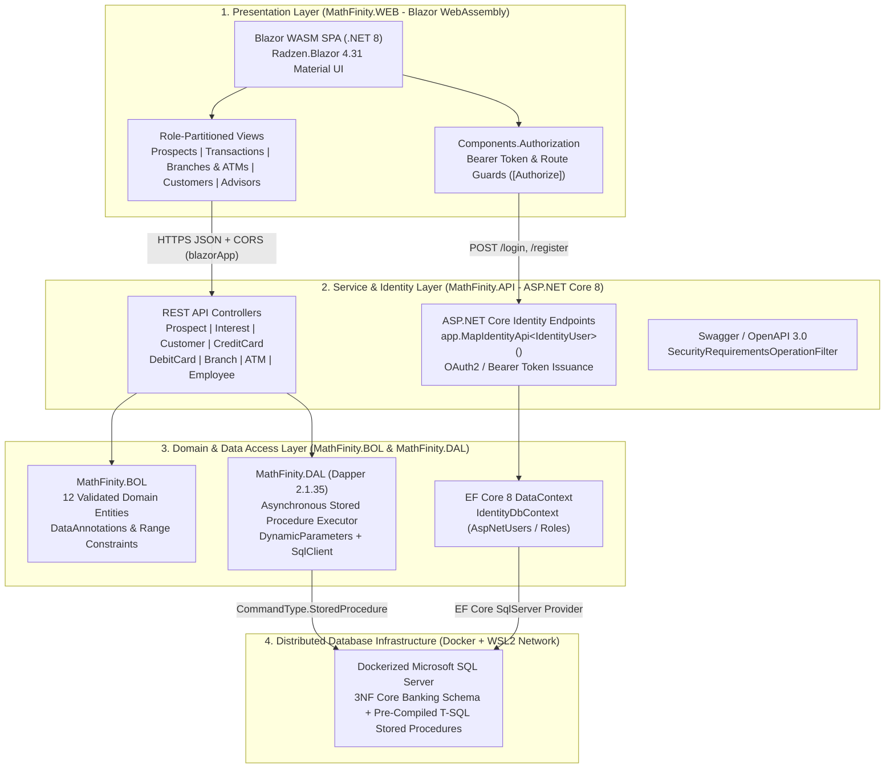
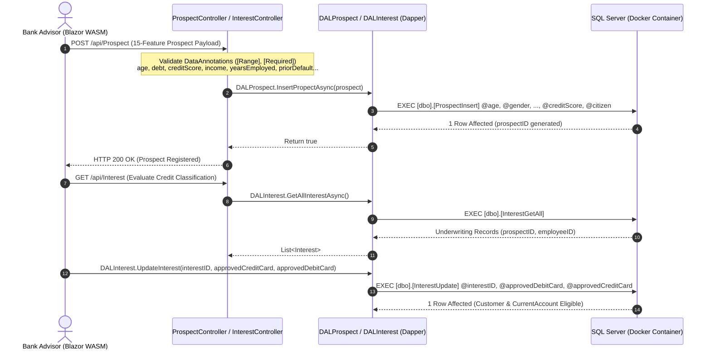

# MathFinity: Distributed Core Banking, Credit Prospect Classification & Transactional Ledger Platform

  

    

      Published
      May 2024
    

    

      Role
      Backend &amp; Database Architect
    

    

      Domain
      Core Retail Banking, Credit Risk Underwriting &amp; Distributed Databases
    

  

  

  
Technology Stack

  

    .NET 8 Core (C#)
    Blazor WebAssembly
    ASP.NET Core 8 Web API
    Dapper 2.1 &amp; EF Core 8 Identity
    Microsoft SQL Server
    Docker &amp; WSL2 Virtual Network
    Radzen Blazor UI
    Credit Risk Classification Model
  

---

## Executive Summary

**MathFinity** is a 4-layer enterprise banking and credit risk management platform built on **.NET 8**, **Blazor WebAssembly**, **ASP.NET Core 8 Web API**, **Dapper**, and a **distributed Microsoft SQL Server database containerized with Docker over WSL2**.

Designed to model the end-to-end operational lifecycle of a retail bank, the platform unifies **automated credit card prospect classification**, **advisor-assisted customer onboarding**, **checking account and dual-card issuance (Credit & Debit)**, **branch and ATM cash-vault administration**, and **disjoint financial transaction processing (inter-account wire transfers and cardless ATM withdrawals)** behind a 100% Stored-Procedure Data Access Layer.

---

## 1. Core Business Logic & Banking Problems Solved

Retail banking systems must simultaneously enforce strict relational integrity on financial ledgers while providing rapid, data-driven credit underwriting for new applicants. MathFinity solves five core business challenges:

### 1.1 Automated Credit Card Prospect Classification (15-Feature Risk Model)
Before an applicant can open a credit line, the bank must evaluate default risk across socioeconomic, demographic, and credit-bureau variables. MathFinity captures and validates **15 standardized credit risk features** in the `Prospect` domain model (`MathFinity.BOL/Prospect.cs`):
- **Demographic & Stability Indicators**: `age` (`[0..100]`), `gender` (`0/1`), `married` (`0/1`), `driversLicense` (`0/1`), `citizen` status, `Ethnicity`, and `zipCode`.
- **Employment & Cash-Flow Capacity**: `employed` (`0/1`), `yearsEmployed` (`[0..100]`), `industry` sector, and gross `income`.
- **Credit Bureau & Historical Exposure**: current `debt` ratio (`[0..1]`), existing `bankCustomer` relationship (`0/1`), historical `priorDefault` flag (`0/1`), and bureau `creditScore`.

These 15 attributes feed the credit approval classification pipeline to determine whether the prospect qualifies for a revolving credit line (`approvedCreditCard`) and/or a checking debit instrument (`approvedDebitCard`).

### 1.2 Advisor Underwriting & 1:1 Prospect-to-Customer Conversion
Rather than mixing unverified applicants with active account holders, MathFinity enforces a strict 3-stage onboarding state machine in SQL Server:
1. **Prospect Registration (`Prospect`)**: Captures the 15 risk classification attributes via `[dbo].[ProspectInsert]`.
2. **Advisor Underwriting Evaluation (`Interest`)**: Links a bank advisor (`Employee`) to the `Prospect` (`1:1`), recording the evaluation timestamp (`dateInterest`) and the binary underwriting decisions (`approvedCreditCard`, `approvedDebitCard`) via `[dbo].[InterestInsert]` and `[dbo].[InterestUpdate]`.
3. **Customer & Account Provisioning (`Customer` -> `CurrentAccount`)**: Once approved, the `Interest` record converts `1:1` into a permanent `Customer` profile (`customerID`, `interestID`, `address`, `phone`, `dateCreate`) linked `1:1` to an authenticated `AspNetUsers` identity and a `CurrentAccount` (`accountNumber`, `accountKey`).

### 1.3 Dual-Card Instrument Lifecycle (Credit & Debit Cards)
Each `CurrentAccount` supports independent `(0:1)` to `(1:1)` relationships with two distinct payment instruments:
- **Revolving Credit Card (`CreditCard`)**: Tracks `cardNumber`, `accountNumber`, assigned `creditLimit`, current `balance`, billing `closingDate`, payment `dueDate`, `issueDate`, `expireDate`, `CVV`, and encrypted `NIP`.
- **Checking Debit Card (`DebitCard`)**: Tracks `cardNumber`, `accountNumber`, available liquid `balance`, `issueDate`, `expireDate`, `CVV`, and `NIP` for ATM and POS authorization.

### 1.4 Disjoint Transactional Ledger (Transfers vs. ATM Withdrawals)
To prevent schema pollution and null-column sparsity in the financial ledger, `Transaction` (`transactionNumber`, `amount`, `approved`, `date`, `accountNumber`) acts as a relational supertype with a **disjoint `1:1` specialization** into two concrete transaction subtypes:
- **Inter-Account Wire Transfer (`Transfer`)**: Records `transferNumber`, `issuingAccount`, `destinatioAccount`, and foreign key `transactionNumber`.
- **Cardless / ATM Cash Withdrawal (`WithDrawal`)**: Records `withDrawalNumber`, one-time `securityCode`, and `transactionNumber`, executed against a physical `ATM` unit (`ATMID`, `cashInBox`, `branchID`).

### 1.5 Physical Branch & ATM Cash-Vault Administration
Bank branches (`Branch`) operate under strict physical capacity rules modeled directly in the relational schema:
- Each `Branch` (`branchID`, `name`, `address`) manages `(0:N)` bank `Employee` staff members (`employeeID`, `rol`, `hiredDate`, `firstName`, `lastName`, `birthDate`, `sex`).
- Each `Branch` hosts between `(0:3)` physical `ATM` terminals (`ATMID`, `branchID`, `cashInBox`), enabling real-time monitoring of cash liquidity across the branch network.

---

## 2. System Architecture & 4-Layer .NET 8 Topology

MathFinity is structured as a decoupled 4-project **.NET 8** solution (`MathFinity.sln`) communicating over HTTPS and a bridged Docker virtual network connecting the API host to the distributed SQL Server instance:

### Architectural Breakdown by Project

| Solution Project | Target Framework | Key Dependencies | Primary Architectural Responsibility |
| :--- | :--- | :--- | :--- |
| **`MathFinity.WEB`** | `net8.0` (`BlazorWebAssembly`) | `Radzen.Blazor 4.31.2`, `Components.Authorization 8.0.4`, `Newtonsoft.Json` | Client-side Single Page Application (SPA) rendering interactive data grids, navigation sidebars (`MainLayout.razor`), and `[Authorize]`-protected prospect and customer workflows. |
| **`MathFinity.API`** | `net8.0` (`Sdk.Web`) | `Identity.EntityFrameworkCore 8.0.4`, `Swashbuckle.AspNetCore.Filters 8.0.2`, `ClosedXML 0.102.2` | Stateless REST API hosting 8 banking controllers, ASP.NET Core Identity token endpoints (`MapIdentityApi<IdentityUser>`), CORS policy enforcement, and multi-stage Linux Docker packaging (`EXPOSE 8242`). |
| **`MathFinity.DAL`** | `net8.0` (`Sdk`) | `Dapper 2.1.35`, `System.Data.SqlClient 4.8.6`, `Extensions.Configuration.Json 8.0.0` | High-performance Data Access Layer managing `SqlConnection` lifecycles (`DALDataConnection`) and executing pre-compiled SQL Server Stored Procedures via `DynamicParameters`. |
| **`MathFinity.BOL`** | `net8.0` (`Sdk`) | `System.ComponentModel.DataAnnotations` | Pure Business Object Layer defining the 12 core banking entities (`Prospect`, `Interest`, `Customer`, `CurrentAccount`, `CreditCard`, `DebitCard`, `Transaction`, `Transfer`, `WithDrawal`, `Branch`, `Employee`, `ATM`). |

---

## 3. Credit Prospect Classification & Onboarding Flow

When a prospective client applies for a credit card, the system validates all 15 feature constraints at the `MathFinity.BOL` model boundary before persisting the vector into SQL Server and routing it for underwriting:

### Validated Credit Classification Feature Vector (`MathFinity.BOL/Prospect.cs`)

| Feature Name | C# Type | Validation Attributes | Risk Classification Role |
| :--- | :--- | :--- | :--- |
| **`age`** | `float` | `[Required]`, `[Range(0, 100)]` | Applicant age in years; captures lifecycle earning stability. |
| **`gender`** | `int` | `[Required]`, `[Range(0, 1)]` | Binary encoded demographic attribute (`0` or `1`). |
| **`married`** | `int` | `[Required]`, `[Range(0, 1)]` | Marital status indicator affecting household risk pooling. |
| **`driversLicense`** | `int` | `[Required]`, `[Range(0, 1)]` | Verified government-issued driver identification flag. |
| **`employed`** | `int` | `[Required]`, `[Range(0, 1)]` | Active employment status at time of application. |
| **`yearsEmployed`** | `float` | `[Required]`, `[Range(0, 100)]` | Continuous tenure in current employment role. |
| **`industry`** | `string` | `[Required]` | Economic sector of employment (categorical feature). |
| **`income`** | `float` | `[Required]` | Verified liquid income supporting debt service coverage. |
| **`debt`** | `float` | `[Required]`, `[Range(0, 1)]` | Normalized debt-to-income obligation ratio (`0.0` to `1.0`). |
| **`creditScore`** | `float` | `[Required]` | External credit bureau quantitative score. |
| **`priorDefault`** | `int` | `[Required]`, `[Range(0, 1)]` | Critical binary flag indicating any historical credit default. |
| **`bankCustomer`** | `int` | `[Required]`, `[Range(0, 1)]` | Indicates whether the applicant already holds an account with the bank. |
| **`citizen`** | `string` | `[Required]` | Citizenship / residency classification (`ByBirth`, `Temporary`, etc.). |
| **`Ethnicity`** | `string` | `[Required]` | Demographic categorization from the benchmark credit dataset. |
| **`zipCode`** | `string` | `[Required]` | Geographic postal zone of the applicant's residence. |

---

## 4. Relational Database Schema & Disjoint Transaction Model

The core banking database was designed from the ground up in **Third Normal Form (3NF)** and deployed across Dockerized SQL Server instances over a WSL2 virtual network. Below is the complete Entity-Relationship (ER) diagram modeling the 12 domain entities and their cardinality constraints:

### Key Relational Design Patterns

1. **Identity Decoupling (`User` vs. `Customer` vs. `Prospect`)**:
   - Authentication credentials, password hashes, security stamps, and 2FA flags reside in `AspNetUsers` (`DataContext : IdentityDbContext`, migration `20240509171444_aspnetIdentity`).
   - Unapproved applicants remain isolated in `Prospect` until an `Employee` completes an `Interest` underwriting record, preventing unverified users from polluting `Customer` or `CurrentAccount` tables.
2. **Disjoint `1:1` Transaction Subtyping (`Transaction` -> `Transfer` | `WithDrawal`)**:
   - Every financial movement creates an atomic parent row in `Transaction` (`transactionNumber`, `amount`, `approved`, `date`, `accountNumber`).
   - Depending on the operation type, the transaction branches into either `Transfer` (`transferNumber`, `issuingAccount`, `destinatioAccount`) or `WithDrawal` (`withDrawalNumber`, `securityCode`), preserving strict foreign-key referential integrity without nullable subtype columns.
3. **Physical Branch Capacity Constraints (`Branch` -> `ATM` & `Employee`)**:
   - A `Branch` (`branchID`, `name`, `address`) is linked `(1:1)-(0:3)` to `ATM` machines (`ATMID`, `cashInBox`) and `(1:1)-(0:N)` to `Employee` records, ensuring every ATM cash withdrawal (`WithDrawal`) is traceable to a physical vault and branch location.

---

## 5. Dapper Stored-Procedure DAL & Defensive Security Architecture

To maximize throughput and eliminate ORM query compilation overhead on transactional banking tables, `MathFinity.DAL` executes **100% pre-compiled SQL Server Stored Procedures** using `Dapper` (`2.1.35`) and `System.Data.SqlClient`.

### 5.1 Complete Stored Procedure Inventory (`MathFinity.DAL`)

| DAL Class | C# Asynchronous Method | Target SQL Server Stored Procedure | Parameters & Direction |
| :--- | :--- | :--- | :--- |
| **`DALProspect`** | `GetAllProspectAsync()` `GetByIdProspectAsync(int id)` `InsertPropectAsync(Prospect)` | `[dbo].[ProspectGetAll]` `[dbo].[ProspectGetById]` `[dbo].[ProspectInsert]` | None `@prospectID` 14 input parameters (`@age`..`@citizen`) |
| **`DALInterest`** | `GetAllInterestAsync()` `UpdateInterest(Interest)` `InterestInsertAsync()` | `[dbo].[InterestGetAll]` `[dbo].[InterestUpdate]` `[dbo].[InterestInsert]` | None `@interestID`, `@approvedDebitCard`, `@approvedCreditCard` None |
| **`DALCustomer`** | `CustomerGetAllAsync()` `CustomerGetByIdAsync(string id)` `EditCustomerAsync(Customer)` | `[dbo].[CustomerGetAll]` `[dbo].[CustomerGetById]` `[dbo].[CustomerEdit]` | None `@customerID` `@customerID`, `@phone`, `@address` |
| **`DALCurrentAccount`** | `CurrentAccountGetAllAsync()` `CurrentAccountGetByIdAsync(string)` | `[dbo].[CurrentAccountGetAll]` `[dbo].[CurrentAccountGetById]` | None `@accountNumber` |
| **`DALCreditCard`** | `CreditCardGetAllAsync()` `CreditCardGetByIdAsync(string)` | `[dbo].[CreditCardGetAll]` `[dbo].[CreditCardGetById]` | None `@cardNumber` |
| **`DALDebitCard`** | `DebitCardGetAllAsync()` `DebitCardGetByIdAsync(string)` `DebitCardLogInAsync(DebitCard)` | `[dbo].[DebitCardGetAll]` `[dbo].[DebitCardGetById]` `[dbo].[DebitCardLogIn]` | None `@cardNumber` `@cardNumber`, `@NIP` |
| **`DALTransaction`** | `TransactionGetAllAsync()` `TransactionGetById(int id)` | `[dbo].[TransferGetAll]` `[dbo].[TransactionGetById]` | None `@transactionNumber` |
| **`DALBranch`** | `GetAllBranchAsync()` `GetBranchByIdAsync(int id)` `InsertBranchAsync(Branch)` | `[dbo].[BranchGetAll]` `[dbo].[BranchGetById]` `[dbo].[BranchInsert]` | None `@branchID` `@address`, `@name` |
| **`DALATM`** | `GetAllATM()` `GetATMById(int id)` `InsertATMAsync(ATM)` | `[dbo].[ATMGetAll]` `[dbo].[ATMGetById]` `[dbo].[ATMInsert]` | None `@ATMID` `@branchID`, `@cashInBox` |
| **`DALEmployee`** | `GetAllEmployessAsync()` `GetEmployeeByIdAsync(int id)` `InsertEmployeeAsync(Employee)` `UpdateEmployee(Employee)` | `[dbo].[EmployeeGetAll]` `[dbo].[EmployeeGetById]` `[dbo].[EmployeeInsert]` `[dbo].[EmployeeUpdate]` | None `@employeeID` 7 employee attributes 8 employee attributes |

### 5.2 SQL Injection Benchmarking (`DebitCardLogInAsync` vs. `DebitCardLogInAsyncTest`)
To demonstrate why financial applications must enforce parameterized stored procedures at the data layer, `DALDebitCard.cs` and `DebitCardController.cs` implement a side-by-side security comparison endpoint:
- **Production Hardened Endpoint (`GET /api/DebitCard/{cardNumber}/{NIP}`)**: Invokes `DALDebitCard.DebitCardLogInAsync`, binding `@cardNumber` and `@NIP` as strongly-typed `DynamicParameters` passed to `[dbo].[DebitCardLogIn]` (`CommandType.StoredProcedure`). Payloads containing T-SQL metacharacters are treated strictly as literal byte buffers.
- **Vulnerability Benchmark Endpoint (`GET /api/DebitCard/test/{cardNumber}/{NIP}`)**: Invokes `DALDebitCard.DebitCardLogInAsyncTest` during security testing Labs to demonstrate how unparameterized string interpolation (`SqlCommand`) exposes authentication queries to tautology injection, validating the necessity of the Dapper Stored Procedure architecture.

### 5.3 Extensibility: Stored-Procedure Output Aggregation & In-Memory OpenXML Reporting
The 4-layer `MathFinity` foundation (`Blazor WASM + RadzenDataGrid` -> `ASP.NET Core 8 Web API` -> `Dapper DAL` -> `Dockerized SQL Server`) was also extended to power enterprise B2B campaign and shipment tracking modules (`ProyectoController`, `EnviosController`, `DALProyecto`, `DALEnvios`):
- **Server-Side KPI Calculation via SQL `OUTPUT` Parameters**: Rather than transferring thousands of rows to calculate completion percentages on the client, `DALEnvios.ObtenerPorcentajeEnvios` binds `parameters.Add("@porcentaje", dbType: DbType.Single, direction: ParameterDirection.Output)` and executes `[dbo].[ProyectoGetStatistics]`, binding the resulting scalar directly to a `<RadzenProgressBar>` component.
- **Zero-Disk In-Memory Excel Generation (`ClosedXML`)**: The `/api/Envios/Excel` endpoint populates an in-memory `System.Data.DataTable`, compiles an OpenXML `.xlsx` workbook via `XLWorkbook` into a `MemoryStream`, and streams the binary `application/vnd.openxmlformats-officedocument.spreadsheetml.sheet` payload directly to the browser without touching container disk storage.

---

[Back to Portfolio](../../index.md)
