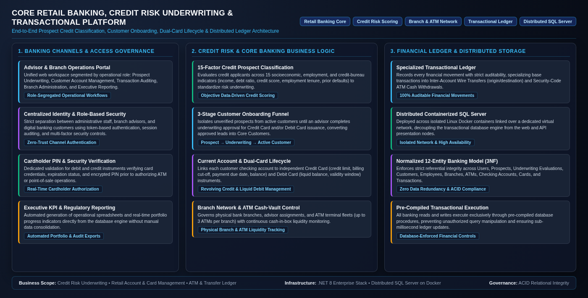
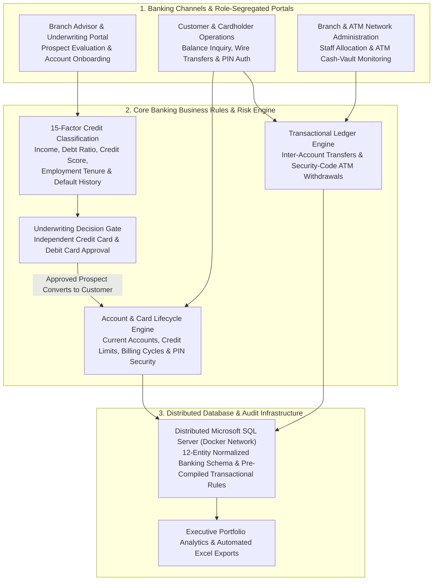
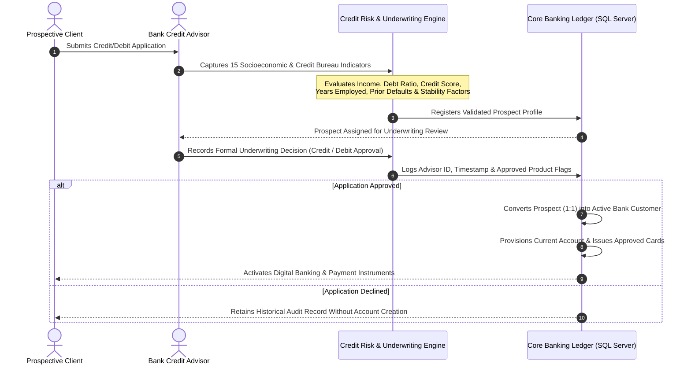
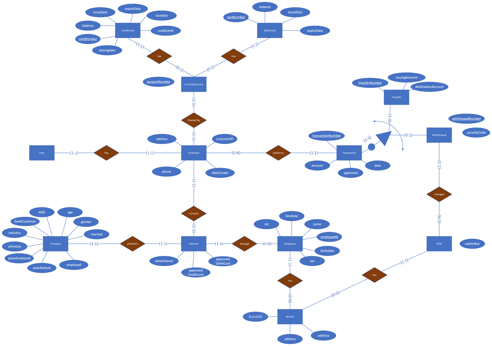

# Core Retail Banking, Credit Risk Underwriting & Distributed Transactional Platform

  

    

      Published
      May 2024
    

    

      Role
      Backend &amp; Database Architect
    

    

      Domain
      Core Retail Banking, Credit Risk Underwriting, Branch/ATM Liquidity &amp; Financial Ledger Governance
    

  

  

    Technology Stack
    

      .NET 8 Enterprise Stack
      Blazor WebAssembly
      RESTful Banking API
      Distributed Microsoft SQL Server
      Docker &amp; Isolated Virtual Network
      Credit Risk Classification Model
      Role-Based Access Governance
    

  

---

## Executive Summary

This platform was engineered to modernize and centralize the core operational workflows of a retail banking institution. Built over a **distributed Microsoft SQL Server architecture containerized in Docker**, the system unifies **data-driven credit card underwriting**, **advisor-assisted customer onboarding**, **checking account and dual-card issuance (Credit and Debit)**, **physical branch and ATM cash-vault management**, and **auditable financial transaction processing**.

By separating prospective applicants from active account holders and enforcing strict relational controls across every financial movement, the platform eliminates manual underwriting bottlenecks, reduces credit default exposure, and guarantees end-to-end auditability across branch, web, and ATM channels.

---

## 1. Core Banking Problems Solved & Business Value

Retail banking operations require balancing two competing priorities: **accelerating customer acquisition** for credit and debit products while **maintaining strict risk and accounting controls**. The platform resolves five critical business challenges:

### 1.1 Objective Credit Risk Underwriting (15-Factor Classification Model)
Manual credit evaluations are slow, inconsistent across branches, and prone to human bias. To standardize credit origination, the platform evaluates every credit applicant across **15 standardized socioeconomic, employment, and credit-bureau indicators** before approving a credit line:
- **Financial Capacity & Cash Flow**: Verified annual income, continuous years of employment, current employment status, and economic industry sector.
- **Credit Bureau & Repayment History**: External credit score, current debt-to-income obligation ratio, historical default record (prior defaults), and existing relationship with the bank.
- **Demographic & Stability Profile**: Applicant age, marital status, residency/citizenship status, verified driver identification, and geographic postal zone.

By structuring these 15 indicators at the point of capture, the bank feeds a classification model that objectively determines whether an applicant qualifies for a **Revolving Credit Card**, a **Checking Debit Card**, or both.

### 1.2 Controlled 3-Stage Customer Onboarding Funnel
In many legacy systems, unverified leads and rejected credit applicants are stored alongside active bank customers, creating compliance and data-governance risks. This platform enforces a strict **3-stage conversion funnel**:
1. **Prospect Capture**: Prospective applicants are registered in an isolated prospect repository with their 15 risk profile indicators.
2. **Advisor Underwriting Evaluation**: A branch advisor reviews the classification output and records a formal underwriting decision (approving or declining Credit Card and Debit Card eligibility) stamped with the advisor's identity and evaluation date.
3. **Customer & Core Account Conversion**: Only when underwriting is approved does the prospect convert into an active **Bank Customer**, automatically enabling the creation of a **Current Account (Checking Account)** and digital banking credentials.

### 1.3 Dual Payment Instrument Lifecycle (Credit vs. Debit Cards)
Once a customer holds an active Current Account, the bank can issue and manage two distinct financial instruments with independent business rules:
- **Revolving Credit Cards**: Governed by an assigned credit limit, billing cut-off date (closing date), payment due date, current utilized balance, validity window (issue and expiration dates), security verification code, and encrypted PIN.
- **Checking Debit Cards**: Directly tied to the customer's liquid checking balance, governed by validity dates, security verification codes, and encrypted PIN authentication for ATM and point-of-sale usage.

### 1.4 Segregated Financial Transaction Ledger (Wire Transfers vs. ATM Withdrawals)
Not all banking transactions carry the same operational metadata or risk profile. Rather than forcing all movements into a single generic table filled with empty fields, the financial ledger separates transactions into a **Master Transaction Record** (capturing the unique transaction number, monetary amount, timestamp, approval status, and source account) and two specialized operational sub-ledgers:
- **Inter-Account Wire Transfers**: Tracks the issuing source account and destination beneficiary account for traceable electronic funds transfers.
- **Security-Code ATM Cash Withdrawals**: Tracks cardless or ATM cash dispensations authorized via a one-time security code and links each withdrawal directly to the physical ATM terminal that dispensed the cash.

### 1.5 Branch Network & ATM Cash-Vault Liquidity Management
Physical banking infrastructure requires continuous oversight of human capital and cash reserves:
- **Branch Governance**: Centralizes the directory of physical bank branches, their geographic locations, and assigned staff roles (branch managers, credit advisors, and operations personnel).
- **ATM Fleet & Cash-in-Box Tracking**: Enforces a physical governance rule allowing up to **3 ATM terminals per branch**, monitoring the real-time cash available inside each machine vault (`Cash in Box`) to prevent cash-out events and optimize armored cash-replenishment routes.

---

## 2. End-to-End Business Workflow Architecture

The following diagram illustrates how customer acquisition, credit risk underwriting, account provisioning, and transactional execution interact across the bank's operational layers:

---

## 3. Credit Underwriting & Customer Conversion Lifecycle

From an executive governance standpoint, every new credit line follows a fully traceable approval sequence that links the applicant, the evaluating bank advisor, and the resulting financial account:

### The 15 Credit Underwriting Indicators

| Evaluation Dimension | Business Indicators Evaluated | Risk Governance Objective |
| :--- | :--- | :--- |
| **Repayment History & Bureau Score** | External Credit Score, Prior Default History, Existing Bank Customer Status | Identifies historical delinquency behavior and rewards established customers with verified payment track records. |
| **Debt Capacity & Cash Flow** | Gross Income, Current Debt-to-Income Ratio | Measures disposable liquidity and prevents over-leveraging the applicant beyond sustainable debt service thresholds. |
| **Employment Stability** | Employment Status, Continuous Years Employed, Industry Sector | Evaluates income continuity and accounts for macroeconomic volatility across different employment sectors. |
| **Demographic & Identity Verification** | Age, Marital Status, Citizenship/Residency, Verified Driver License, Ethnicity, Postal Code | Completes Know-Your-Customer (KYC) verification and actuarial risk segmentation. |

---

## 4. Enterprise Data Model & Financial Auditability

To guarantee **zero data redundancy** and **strict referential integrity**, the database is structured into 12 normalized business entities deployed across containerized SQL Server instances connected over an isolated virtual network:

### Executive Governance Built into the Data Model

| Business Domain | Core Entities | Operational & Financial Controls Enforced |
| :--- | :--- | :--- |
| **Origination & KYC** | `Prospect`, `Interest`, `Customer`, `User` | Unapproved applicants cannot hold accounts or execute transactions. Every active `Customer` traces back `1:1` to a signed `Interest` underwriting approval and an authenticated digital `User` identity. |
| **Accounts & Cards** | `CurrentAccount`, `CreditCard`, `DebitCard` | A `Customer` owns a `CurrentAccount` (`1:1`), which governs up to one revolving `CreditCard` and one liquid `DebitCard`, centralizing account auditing while keeping credit limits and checking balances segregated. |
| **Transactional Ledger** | `Transaction`, `Transfer`, `WithDrawal` | Every financial operation generates an immutable parent `Transaction` record (`amount`, `date`, `approved`) and branches exclusively into either an electronic `Transfer` or a physical `WithDrawal`. |
| **Physical Network** | `Branch`, `Employee`, `ATM` | Every `Employee` and `ATM` is bound to a physical `Branch`. Each `Branch` is capped at a maximum of `3` `ATM` units, and every cash `WithDrawal` is reconciled against the specific ATM's cash vault (`cashInBox`). |

---

## 5. Security, Compliance & Executive Reporting Capabilities

Beyond core banking transactions, the platform incorporates three architectural safeguards designed for enterprise operations:

1. **Database-Enforced Transactional Integrity**:
   - External applications cannot execute arbitrary or ad-hoc queries against the banking tables. All financial reads, customer updates, and card authorizations are processed exclusively through pre-compiled database procedures, protecting the ledger against unauthorized manipulation and SQL injection attacks.
2. **Distributed Containerized Deployment**:
   - The relational database engine and the application services run in isolated Linux Docker containers linked across a private virtual network, allowing the institution to scale storage, enforce network-level firewalls, and replicate environments consistently across development and production.
3. **Real-Time KPI Aggregation & Executive Spreadsheet Exports**:
   - Management dashboards compute portfolio progress metrics directly inside the database engine and allow executives to export filtered operational records into formatted Excel workbooks generated entirely in memory for immediate financial auditing.

---

[Back to Portfolio](../../index.md)
