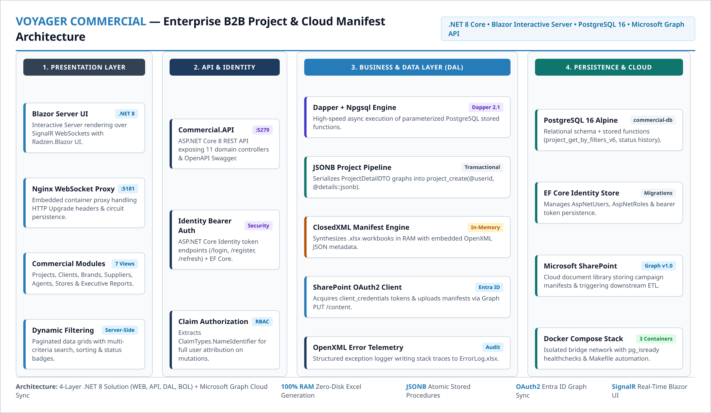
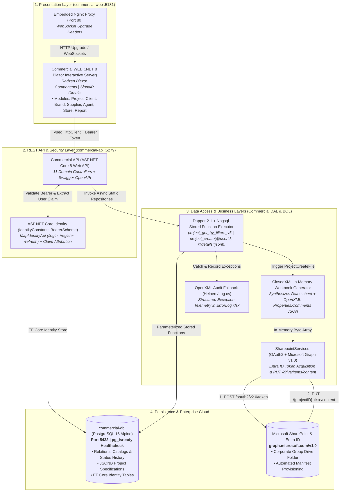
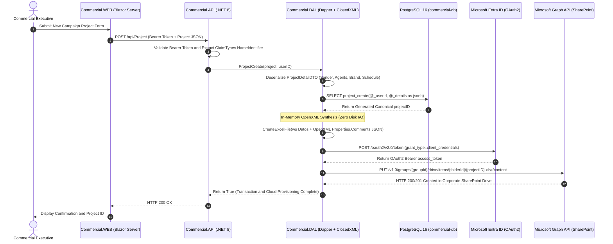

<style>
.project-meta-card {
   background: #f8fafc;
   border: 1px solid #e2e8f0;
   border-left: 4px solid #267CB9;
   border-radius: 6px;
   padding: 16px 18px;
   margin: 16px 0 24px 0;
   font-family: "Noto Sans", "Helvetica Neue", Helvetica, Arial, sans-serif;
}
.project-meta-grid {
   display: grid;
   grid-template-columns: repeat(auto-fit, minmax(180px, 1fr));
   gap: 12px 20px;
   padding-bottom: 12px;
   border-bottom: 1px solid #e2e8f0;
   margin-bottom: 12px;
}
.project-meta-item {
   display: flex;
   flex-direction: column;
}
.project-meta-item.full-width {
   grid-column: 1 / -1;
}
.project-meta-label {
   font-size: 10.5px;
   font-weight: 700;
   text-transform: uppercase;
   letter-spacing: 0.06em;
   color: #267CB9;
   margin-bottom: 3px;
}
.project-meta-value {
   font-size: 13.5px;
   color: #222222;
   font-weight: 400;
   line-height: 1.4;
}
.project-stack-list {
   display: flex;
   flex-wrap: wrap;
   gap: 6px;
   margin-top: 6px;
}
.tech-badge {
   display: inline-block;
   background: #ffffff;
   color: #267CB9;
   border: 1px solid #bcd6eb;
   border-radius: 4px;
   padding: 2px 9px;
   font-size: 12px;
   font-weight: 400;
   line-height: 1.5;
}
</style>

# Voyager Commercial ERP: Enterprise B2B Project & Cloud Manifest Platform

<div class="project-meta-card">
  <div class="project-meta-grid">
    <div class="project-meta-item">
      <span class="project-meta-label">Published</span>
      <span class="project-meta-value">September 2026</span>
    </div>
    <div class="project-meta-item">
      <span class="project-meta-label">Role</span>
      <span class="project-meta-value">Full-Stack .NET Architect &amp; Systems Engineer</span>
    </div>
    <div class="project-meta-item full-width">
      <span class="project-meta-label">Domain</span>
      <span class="project-meta-value">B2B Commercial Operations, Campaign Project Management &amp; Automated Cloud Manifest Provisioning</span>
    </div>
  </div>
  <div class="project-meta-item">
    <span class="project-meta-label">Technology Stack</span>
    <div class="project-stack-list">
      <span class="tech-badge">.NET 8 Core (C#)</span>
      <span class="tech-badge">Blazor Interactive Server</span>
      <span class="tech-badge">Radzen.Blazor UI</span>
      <span class="tech-badge">ASP.NET Core Web API</span>
      <span class="tech-badge">ASP.NET Core Identity (Bearer)</span>
      <span class="tech-badge">Dapper 2.1 &amp; Npgsql</span>
      <span class="tech-badge">Entity Framework Core</span>
      <span class="tech-badge">PostgreSQL 16 Alpine</span>
      <span class="tech-badge">ClosedXML (OpenXML)</span>
      <span class="tech-badge">Microsoft Graph API (SharePoint)</span>
      <span class="tech-badge">Docker &amp; Nginx</span>
    </div>
  </div>
</div>



---

## Executive Summary

In B2B logistics and distribution, every operational campaign begins in the commercial department: defining corporate clients, brands, authorized service levels, delivery schedules, suppliers, and commercial agents. Manually translating commercial agreements into operational logistics templates often leads to disconnected spreadsheets, missing project identifiers, and delayed warehouse onboarding.

To bridge commercial sales and warehouse execution for **TraPoist**, I architected and built **Voyager Commercial App**: a containerized 4-layer **.NET 8** enterprise platform (`Commercial.WEB`, `Commercial.API`, `Commercial.DAL`, `Commercial.BOL`) backed by **PostgreSQL 16** and **Microsoft Graph API (SharePoint)**. When a commercial executive registers a new campaign project, the system atomically persists the relational and `JSONB` payload in PostgreSQL, dynamically synthesizes an OpenXML Excel manifest (`.xlsx`) in memory with embedded internal metadata, authenticates against **Microsoft Entra ID (OAuth2 `client_credentials`)**, and provisions the workbook directly into the corporate SharePoint drive to trigger downstream logistics ETL pipelines.

---

## 1. Multi-Layered .NET 8 Solution Architecture

The solution (`Trapoist.sln`) strictly enforces separation of concerns across four projects orchestrated inside a 3-container Docker Compose topology (`commercial-web`, `commercial-api`, `commercial-db`):



---

## 2. Deep-Dive: Core Engineering Components

### A. `Commercial.WEB` — Blazor Interactive Server with Embedded Nginx WebSocket Proxy
* **SignalR Real-Time Interactivity:** Built on **.NET 8 Blazor Interactive Server** and **Radzen.Blazor**, delivering rich desktop-grade data grids, modal forms, and multi-criteria filtering without duplicating client-side state logic.
* **Dual-Process Container Architecture (`Dockerfile` + `start.sh` + `nginx.conf`):**
  * Inside `commercial-web`, a lightweight shell entrypoint (`start.sh`) launches an embedded **Nginx** instance in the background on port `80` while running `dotnet Commercial.WEB.dll` as the PID 1 foreground process.
  * Nginx proxies traffic to Kestrel (`http://localhost:5181`) with explicit WebSocket upgrade headers (`proxy_set_header Upgrade $http_upgrade;` and `proxy_set_header Connection "upgrade";`), ensuring resilient Blazor SignalR connections across corporate firewalls.
* **Domain Modules:** Dedicated Razor component suites for **Projects (`Project`)**, **Corporate Clients (`Client`)**, **Brands (`Brand`)**, **Suppliers (`Supplier`)**, **Commercial Agents (`Agent`)**, **Retail Stores (`Store`)**, and **Executive Reports (`Report`)**, coupled with a centralized query-string builder (`UrlBuilder.cs`).

### B. `Commercial.API` — Hybrid Identity & Domain REST Controllers
* **Dual Persistence Pattern (EF Core + Dapper):**
  * Uses **Entity Framework Core 9 (`Npgsql.EntityFrameworkCore.PostgreSQL`)** exclusively for **ASP.NET Core Identity** (`ApplicationDbContext`, `IdentityUser`, `IdentityRole`) and automatic token endpoints (`app.MapIdentityApi<IdentityUser>()`).
  * Uses **Identity Bearer Tokens (`IdentityConstants.BearerScheme`)** rather than manual cookie sessions, enabling clean stateless authentication between Blazor Server, Swagger UI, and external API consumers.
* **Claim-Based Audit Attribution:** Write operations (`[HttpPost]`, `[HttpPut]`) decorated with `[Authorize]` extract the authenticated operator's identity directly from cryptographic token claims (`User.FindFirst(ClaimTypes.NameIdentifier)?.Value`) and pass `@_userid` down into PostgreSQL stored procedures for immutable audit trails.

### C. `Commercial.DAL` — Stored Function Pipeline & In-Memory SharePoint Provisioning
Rather than executing chatty ORM queries over the network, `Commercial.DAL` leverages **Dapper (`2.1.35`)** over raw `NpgsqlConnection` instances calling optimized PostgreSQL stored functions:

1. **Server-Side Paginated Filtering (`project_get_by_filters_v6`):** Passes `@_top`, `@_skip`, `@_orderby`, `@_orderdirection`, `@_searchtext`, and `@_filter` directly to PostgreSQL, returning pre-joined `ProjectViewModel` projections in a single round-trip.
2. **Atomic JSONB Project Creation (`project_create`):** Deserializes complex campaign hierarchies (`ProjectDetailDTO`: sender client, associated agents, recipient brand, schedule windows, and authorized service types) and executes:
   ```sql
   SELECT project_create(@_userid, @_details::jsonb);
   ```
   PostgreSQL atomically unpacks the `JSONB` document, inserts relational records, and returns the canonical generated `projectID` (e.g., `PR26-XXXX`).
3. **Zero-Disk OpenXML Manifest Synthesis (`ClosedXML`):** Immediately after `project_create` returns the new `projectID`, `ProjectCreateFile` constructs an Excel workbook (`Datos` worksheet) in memory (`MemoryStream`) via `ClosedXML`:
   * Populates structured project headers (`Proyecto ID`, `Campana`, `Usuarios`, `Servicio Autorizado`, `Fecha de entrega`, `Operadora`) with auto-adjusted column widths.
   * Embeds a serialized JSON metadata dictionary (`_projectid`, `_campaign`, `_clientName`, `_brandName`, `_scheduleType`, `_serviceType`) directly into the OpenXML document properties (`workbook.Properties.Comments`, `Title`, `Author`, and `Content Status = Waiting`).
4. **Automated Microsoft Graph v1.0 Upload (`SharepointServices.cs`):**
   * Requests an OAuth2 `client_credentials` access token from Microsoft Entra ID (`https://login.microsoftonline.com/{tenantId}/oauth2/v2.0/token` with scope `https://graph.microsoft.com/.default`).
   * Streams the in-memory Excel byte array via HTTP `PUT` to `https://graph.microsoft.com/v1.0/groups/{groupId}/drive/items/{folderId}:/{projectID}.xlsx:/content`, making the manifest immediately available to warehouse operators and the automated SharePoint ETL ingestion pipeline.



---

## 3. Container Topology & Specifications

| Container / Layer | Technology | Exposed Port | Key Responsibilities |
| :--- | :--- | :---: | :--- |
| **`commercial-web`** | .NET 8 Blazor Server + Radzen + Nginx | `5181:80` | Interactive UI, SignalR WebSocket proxy, non-root `appuser` (`UID 1000`) execution |
| **`commercial-api`** | ASP.NET Core 8 Web API + Identity | `5279:8080` | 11 REST controllers, Identity Bearer token issuing, Swagger OpenAPI |
| **`Commercial.DAL`** | Dapper 2.1 + ClosedXML + Graph Client | *Library* | Parameterized PostgreSQL stored function calls, in-memory `.xlsx` generation, SharePoint sync |
| **`Commercial.BOL`** | .NET 8 Class Library | *Library* | Domain entities (`Project`, `Client`, `Brand`, `Supplier`, `Agent`), Enums, DTOs & ViewModels |
| **`commercial-db`** | PostgreSQL 16 Alpine | `5432:5432` | Relational persistence, `JSONB` project ingestion, `pg_isready` container healthchecks |

---

## 4. Key Engineering Outcomes

* **End-to-End Commercial-to-Logistics Automation:** Eliminated manual spreadsheet creation and email handoffs between sales executives and logistics coordinators by automatically provisioning metadata-tagged `.xlsx` manifests into SharePoint upon project creation.
* **100% In-Memory Document Generation:** Synthesizing OpenXML workbooks in RAM (`MemoryStream`) and streaming bytes directly to Microsoft Graph API prevented container filesystem bloat and file-locking contention.
* **High-Speed Hybrid Data Access:** Combining EF Core Identity for security management with Dapper + PostgreSQL stored functions (`JSONB` unpacking and server-side pagination) achieved clean maintainability and sub-10ms query execution.
* **Hardened Container Execution:** Multi-stage Docker builds isolate SDK compilation from runtime images and execute the web workload under an unprivileged Linux user (`appuser`, `UID 1000`).
