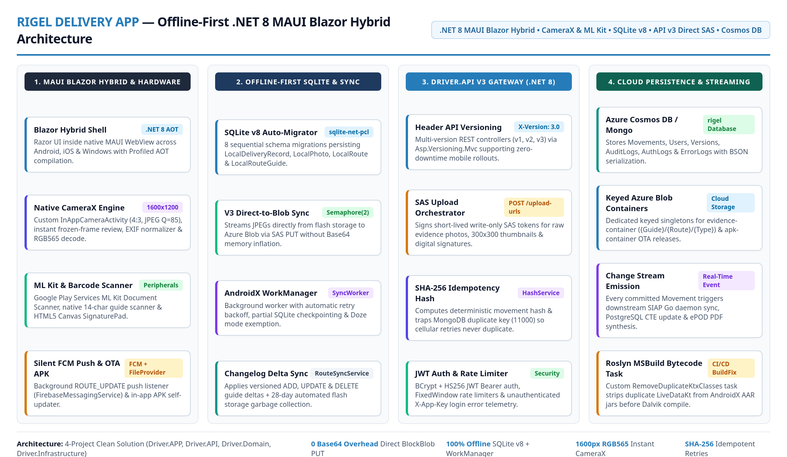
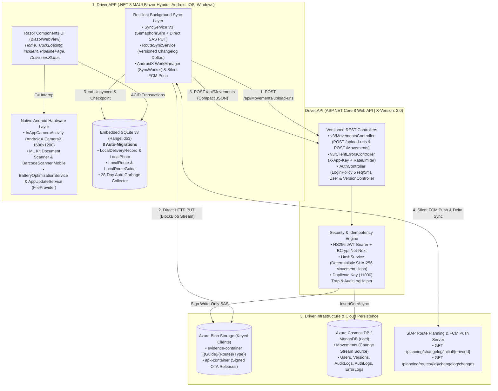
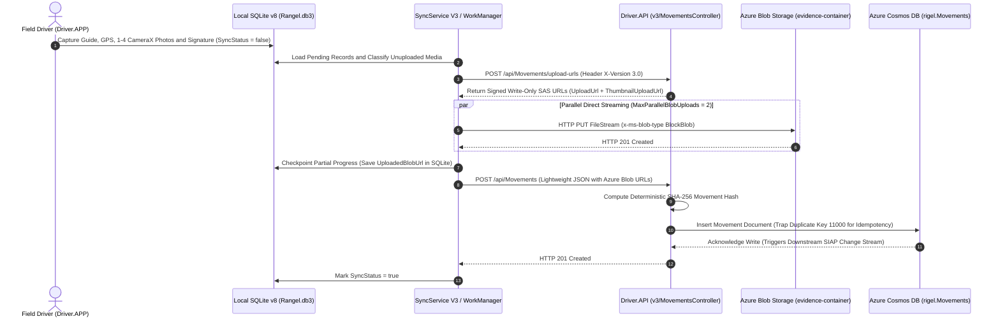

# Delivery APP (Rigel): Offline-First .NET 8 MAUI Blazor Hybrid, Web API v3, SQLite & Azure Cosmos DB

  

    

      Published
      October 2025
    

    

      Role
      Lead Mobile &amp; Backend Systems Architect
    

    

      Domain
      Last-Mile Field Operations, Offline-First Mobile Sync, Hardware CameraX/ML Kit Capture &amp; Electronic Proof of Delivery (ePOD)
    

  

  

    Technology Stack
    

      .NET 8 MAUI Blazor Hybrid
      ASP.NET Core 8 Web API (v1/v2/v3)
      SQLite (sqlite-net-pcl v8)
      Azure Cosmos DB (MongoDB API)
      Azure Blob Storage (Direct SAS)
      AndroidX CameraX &amp; WorkManager
      Google ML Kit Document Scanner
      Firebase Cloud Messaging (FCM)
      JWT Bearer &amp; SHA-256 Idempotency
    

  

---

## Executive Summary

In last-mile logistics, the mobile device in the driver's hand is the primary source of operational truth. Field operators work in environments where cellular connectivity drops constantly—industrial loading docks, rural highways, and地下/concrete receiving bays—while executing hundreds of daily parcel scans, truck-loading checks, customer handovers, and incident reports.

To eliminate missing packages, unverified deliveries, and lost field evidence, I architected and engineered the **Rigel Delivery Platform**: a 4-project **.NET 8 Clean Architecture solution** (`Driver.APP`, `Driver.API`, `Driver.Domain`, `Driver.Infrastructure`) combining an **offline-first .NET 8 MAUI Blazor Hybrid mobile app (`v2.1.4`, Profiled AOT)** with a multi-version **ASP.NET Core 8 Web API (`v1.0`–`v3.0`)**, **embedded SQLite v8**, **Azure Cosmos DB for MongoDB**, and **Azure Blob Storage**.

---

## 1. Business Logic & Last-Mile Operational Problems Solved

Before Rigel, field operations suffered from four core business pain points: drivers accidentally loading packages onto the wrong truck, incomplete delivery evidence (missing signed receipts or blurry photos), unrecorded failed delivery attempts, and 4–8 second UI freezes waiting for GPS locks or cellular uploads. The application enforces strict domain rules at every stage of the last-mile lifecycle:

```mermaid
flowchart LR
    subgraph STAGE1 ["1. Pre-Flight & Dock Loading (Transit)"]
        SyncCheck["Pre-Start Route Sync<br/><i>Verify Latest Server Route</i>"]
        ScanLoad["14-Char Guide Scan<br/><i>Regex: P + 13 Digits</i>"]
        RouteAudit["Route Membership Audit<br/><i>Out-of-Route & Missing Alerts</i>"]
    end

    subgraph STAGE2 ["2. Active Route Execution (PipelinePage)"]
        TwoStage["2-Stage Itinerary Matrix<br/><i>Col 1: Carga/Rec. | Col 2: Entrega</i>"]
        SwipeUX["Swipe-to-Reveal Actions<br/><i>Left: Maps & Action | Right: Incident</i>"]
    end

    subgraph STAGE3 ["3. Customer Handover & Exceptions"]
        EPOD["Mandatory 4-Part ePOD<br/><i>Acuse (ML Kit) + Material + Fachada + Signature</i>"]
        Incident["Structured Incident Report<br/><i>8 Standardized Reasons + Photo Evidence</i>"]
    end

    STAGE1 --> STAGE2 --> STAGE3
```

### A. Pre-Flight Dock Verification & Missing-Parcel Prevention (`TruckLoadingPage.razor`)
* **Blocking Pre-Start Route Synchronization (`PrecheckAndLoadRouteAsync`):** When a driver opens the *Carga de Ruta* module at the warehouse dock, the UI runs a pre-flight check against the planning server to pull any newly assigned route or guide delta before enabling the barcode scanner.
* **Strict 14-Character Barcode Validation:** Every scanned or typed tracking number is validated against the corporate guide rule (**initial letter `P` followed by 13 numeric digits**, e.g., `P0000022737101`), rejecting accidental scans of product UPCs or box serial barcodes.
* **Out-of-Route Interception (`showWrongGuideModal`):** Each scanned guide is cross-checked in O(1) time against the driver's active `routeDeliveryTrackingNumbers` `HashSet`. If a driver scans a parcel belonging to another route, a modal intercepts the scan and requires explicit override confirmation.
* **Incomplete Load Audit (`showRouteValidationModal`):** When the driver finishes loading the truck (`DeliveryStatus.Transit`), the app compares the scanned batch against all planned route deliveries. If parcels are missing (`missingGuidesCount > 0`), it alerts *"Te faltan N guías por cargar de tu ruta"* so no packages are left behind on the warehouse floor.

### B. Two-Stage Operational Itinerary & Multi-Day Route Windowing (`PipelinePage.razor`)
* **Unified Pickup (`RECOLECCIÓN`) & Delivery (`ENTREGA`) Itinerary:** Displays the driver's daily stops ordered by stop sequence (`Parada #N`) and estimated arrival time (`hh:mm tt`), with a date selector spanning multi-day highway routes (`DepartureDay` to `ArrivalDay`).
* **Two-Column Stage Verification Matrix:** Every guide row displays two real-time status indicators:
  1. **Stage 1 (`Carga/Rec.`):** Turns green (`check-circle`) once the parcel has a recorded `Transit` scan. If a driver delivers a parcel without having registered its warehouse load scan, Stage 1 displays an amber warning triangle (*"Entregado sin registrar carga"*).
  2. **Stage 2 (`Entrega`):** Turns green once the final customer delivery (`Delivered`) is recorded.
* **Touch Swipe-to-Reveal Workflow:** Swiping a guide row right reveals the yellow **Incidencia** trigger; swiping left reveals one-tap **Google Maps Turn-by-Turn Navigation** (`Latitude, Longitude`) and the context-aware **Carga / Recolección / Entrega** button.
* **Offline Temporal Window Reconciliation (`GetDailyMovementsStrictLogicAsync`):** When a parcel requires multiple delivery attempts across days, SQLite evaluates each `Transit` exit timestamp and pairs it strictly with `Delivered` events occurring inside the half-open temporal window `[CurrentTransit, NextTransit)`.

### C. Mandatory 4-Part ePOD Capture & Single-Flight GPS Pre-Warming (`Home.razor`)
To guarantee that every generated ePOD PDF is legally indisputable, `IsFormValid()` enforces **4 mandatory evidence components** before committing a `DeliveryStatus.Delivered` movement:
1. **Verified Tracking Guide(s) & Recipient Name (`ReceiverName`):** Supports single or multi-guide batch handovers at a single recipient stop.
2. **Three Categorized Photographic Evidences:**
   * **`ProofOfDelivery` (*Foto de Acuse*):** Routed through the **Google Play Services ML Kit Document Scanner** (`DocumentScannerHelper.cs`) to automatically crop, deskew, and enhance the physical signed waybill, with fallback to the custom CameraX engine.
   * **`Material` (*Foto de Material*):** Visual proof of the physical boxes/pallets in good condition.
   * **`Facade` (*Foto de Fachada*):** Visual proof of the receiving store, warehouse, or residence entrance.
3. **Digital Touch Signature (`SignaturePadDialog.razor`):** Vector stroke signature captured directly on the screen.
4. **Zero-Latency Single-Flight GPS Pre-Warming (`PrewarmLocationInBackground`):**
   * Requesting a cold GPS fix when the driver taps *"Guardar Entrega"* typically blocks mobile UIs for 4 to 8 seconds.
   * I engineered a **single-flight background GPS pre-warmer** (`_inflightLocationTask`) triggered silently as soon as the driver scans a guide (15s cooldown) or returns from taking a photo/signature (5s cooldown). When the driver taps *"Guardar Entrega"*, `GetCurrentLocationAsync()` consumes the pre-warmed coordinate (`age <= 25s`) in **`0ms`**.

### D. Structured Field Exception & Re-Attempt Taxonomy (`IncidentPage.razor`)
When a delivery cannot be completed (`DeliveryStatus.Failed`), the driver logs an incident bound to the tracking guide(s), a mandatory site photo (`Type = "Evidence"`), GPS coordinates, and a standardized `IncidentReason` enum:
* `DireccionIncorrecta` (*Dirección Incorrecta*), `ClienteAusente` (*Cliente Ausente*), `PaqueteDañado` (*Paquete Dañado*), `VehiculoAveriado` (*Vehículo Averiado*), `TraficoClima` (*Tráfico / Clima*), `ClienteRechaza` (*Cliente no quiso recibir*), `LocalCerrado` (*Local Cerrado*), `RutaFueraHorario` (*Ruta fuera de horario*), or `Otro`.
* These structured events flow in real time into the SIAP operations portal to trigger automated customer notifications and route re-planning.

---

## 2. End-to-End 4-Project Solution Architecture

The solution separates cross-platform mobile UI and native hardware hooks from domain logic, cloud storage, and REST API gateways:

---

## 3. Technical Engineering Deep-Dive

### A. V3 Direct-to-Cloud SAS Media Sync Engine (`SyncService.cs`)
In early versions (`v1`/`v2`), embedding 1 to 4 delivery photos and a digital signature as Base64 strings inside a single JSON HTTP POST created multi-megabyte payloads that timed out over weak cellular connections and caused memory spikes (`OutOfMemoryError`). I re-engineered the synchronization pipeline in **API V3 (`X-Version: 3.0`)**:
1. **Stateful Media Classification (`ClassifyRecordMedia`):** Before initiating network calls, `SyncService` inspects each `LocalDeliveryRecord` in SQLite. Photos or signatures that already succeeded in a prior interrupted attempt (`photo.SyncStatus == true` and `UploadedBlobUrl` populated) are automatically reused without re-uploading.
2. **Batch Write-Only SAS Token Acquisition (`POST /api/Movements/upload-urls`):** The app sends a lightweight metadata array (`PhotoId`, `Type`, `ContentType`, `Guide`, `Route`) to `Driver.API`. The backend signs short-lived **Azure Blob Storage SAS URLs** (`UploadUrl` + `ThumbnailUploadUrl`) scoped specifically to `{Guide}/{Route}/{Type}/{PhotoId}`.
3. **Throttled Direct `BlockBlob` Streaming (`UploadPendingMediaAsync`):**
   * Using a dedicated `SocketsHttpHandler` (`ConnectTimeout = 10s`, `PooledConnectionLifetime = 5m`) and a concurrency limiter (`SemaphoreSlim(MaxParallelBlobUploads = 2)`), the app opens a native `FileStream` (`4096`-byte async buffer) directly from device flash storage and executes an `HTTP PUT` (`x-ms-blob-type: BlockBlob`) straight to Azure Blob Storage.
   * After uploading, `UpdateRecordPartialProgressAsync` immediately checkpoints the resulting `BlobUrl` into SQLite so partial progress is never lost if the driver enters a dead zone.
4. **Compact Metadata Commit & SHA-256 Cryptographic Idempotency (`POST /api/Movements`):**
   * Once all media URLs are secured, the app sends a tiny JSON payload (`MovementDto`) containing GPS coordinates, device telemetry, guide numbers, and Azure Blob URLs.
   * `MovementsController` computes a deterministic **SHA-256 hash (`HashService.GenerateMovementHash`)** combining `MovementId + CapturedAt + Guide + ReceiverName + Latitude + Longitude + Signature`. If a mobile retry submits an already-persisted guide, MongoDB raises duplicate-key error `11000`, which the API gracefully logs to `ErrorLog` and returns `201 Created` so the client marks the local record as synced.

---

### B. Custom Native AndroidX CameraX Engine (`InAppCameraActivity.cs`)
Launching the default Android system camera via `MediaPicker` caused two operational issues on mid-range driver phones: 12MP–48MP sensors produced 8–15 MB files that took 2–3 seconds to downsample, and aggressive Android OS memory management occasionally killed the backgrounded MAUI WebView process while the external camera app was open.
* **Embedded `InAppCameraActivity` (`AndroidX.Camera.Core` / `CameraX`):** I built a custom native Android camera activity running inside the same process with hardware-accelerated `PreviewView` (`ScaleType.FitCenter`).
* **Sensor-Level Resolution Selector (`1600x1200` 4:3):** Configures `ResolutionSelector` (`CaptureTargetLongSide = 1600`, `CaptureTargetShortSide = 1200`, `CaptureModeMinimizeLatency`, `JpegQuality = 85`) so the camera ISP outputs optimal ePOD resolution directly without post-capture 48MP downsampling.
* **WhatsApp-Style Instant Frozen-Frame Review & `Rgb565` Decoding:**
  * The millisecond the driver taps the shutter, the UI freezes the live viewfinder bitmap (`_previewView.Bitmap`), triggers a 150ms visual shutter flash, and displays the *Retomar / Usar Foto* controls immediately (`0ms` perceived latency).
  * On a background executor thread (`_cameraExecutor`), `NormalizeImageOrientation` reads EXIF metadata (`ExifInterface`) to normalize rotation, and `DecodeReviewBitmap` decodes the final image using `Bitmap.Config.Rgb565` (consuming **50% less RAM** than `ARGB_8888`).
  * Concurrency is guarded by an atomic `_captureId` (`Interlocked.Increment`) and a `TaskCompletionSource<bool>` (`_captureTcs`), discarding stale frames if the user retakes rapidly.
* **Touch-to-Focus & 4-Mode Flash/Torch:** Supports tap-to-focus metering (`FocusMeteringAction.FlagAf | FlagAe` with animated golden focus box) and 4 lighting states (*Off*, *Auto*, *On*, and continuous *Torch/Flashlight* for dark warehouses).

---

### C. Self-Migrating SQLite v8 Engine & Route Attribution (`DatabaseService.cs`)
* **Zero-Data-Loss Schema Evolution (`CURRENT_DB_VERSION = 8`):** On startup, `DatabaseService` inspects `DatabaseVersion` and sequentially executes idempotent `ALTER TABLE` and `CREATE TABLE` migrations (`MigrationV1Async` through `MigrationV8Async`), adding support for device telemetry (`JsonDeviceDetails`), multi-stage route pickup/delivery coordinates (`LocalRouteGuide`), traceability flags (`IsTraceable`), and multi-day route intervals (`DepartureDay`, `ArrivalDay`).
* **Smart Route Attribution (`ResolveRouteInfoForCaptureAsync`):** When a driver scans a tracking number, the app cross-references `LocalRouteGuide` in SQLite. If the guide belongs to a planned route, it inherits the original `RouteId` and `IsTraceable` flag even if delivered the next day; if it is an ad-hoc manual guide, it dynamically binds to the driver's active route window (`DepartureDay <= localDate <= ArrivalDay`).
* **Automated 28-Day Flash Storage Garbage Collection (`DeleteOldSyncedDeliveries`):** Automatically purges synced SQLite records older than 28 days and physically deletes their associated `.jpg` files from flash storage.

---

### D. Silent FCM Push & Versioned Changelog Delta Sync (`RigelFirebaseMessagingService.cs` & `RouteSyncService.cs`)
Instead of polling or re-downloading entire route manifests over mobile data:
1. **Silent Push Wakeup (`RigelFirebaseMessagingService`):** Extends `FirebaseMessagingService` (`[IntentFilter("com.google.firebase.MESSAGING_EVENT")]`). When dispatchers modify a route in the SIAP portal, the backend sends a silent FCM data message (`"type": "ROUTE_UPDATE"`), waking `RouteSyncService` in the background even if the driver hasn't opened the screen.
2. **Versioned Delta Application (`ProcessDeltas`):** `RouteSyncService` compares `localRoute.CurrentVersion` against the server's `CurrentVersion` and fetches only incremental changes (`GET planning/routes/{routeId}/changelog/changes?version={localVersion}`). It applies ordered `ADD`, `UPDATE`, and `DELETE` deltas to `LocalRouteGuide` in SQLite.
3. **AndroidX `WorkManager` Resilience (`SyncWorker.cs` & `BatteryOptimizationService.cs`):** If a foreground sync fails due to no signal, `SyncWorkerSetup.EnqueueImmediateSyncWork()` schedules a native Android `WorkManager` background job that automatically retries (`Result.InvokeRetry()`) as soon as cellular connectivity returns, supported by native battery optimization exemption prompts (`IBatteryOptimizationService`).

---

### E. Build-Time Roslyn Bytecode Sanitizer & Pre-Auth Error Telemetry
* **Custom MSBuild Roslyn Inline Task (`RemoveDuplicateKtxClasses` in `Driver.APP.csproj`):** Combining modern AndroidX libraries (`Lifecycle.LiveData.Core 2.9.3`, `Work.Runtime`, `CameraX`, and `MLKit.DocumentScanner`) in .NET 8 MAUI triggers R8/D8 duplicate class collisions on `LiveDataKt`. I wrote an inline C# MSBuild task (`TaskFactory="RoslynCodeTaskFactory"`, hooked to `BeforeTargets="_CompileToDalvik"`) that scans intermediate Android AAR archives (`lp/**/classes.jar`) and surgically strips duplicate `LiveDataKt` entries from the ZIP stream before Dalvik compilation.
* **Unauthenticated Login Telemetry (`ErrorTelemetryService.cs` & `ClientErrorsController.cs`):** When a field driver experiences a login failure prior to obtaining a JWT token, the app dispatches a non-blocking 5-second fire-and-forget report authenticated via a static header (`X-App-Key`) and protected on the server by an IP rate limiter (`ClientErrorPolicy`: 20 reports per 10 minutes), capturing `DeviceModel`, `AndroidVersion`, `AppVersion`, and stack context into `ErrorLogs`.

---

## 4. Solution Module Matrix

| Project / Layer | Target Framework | Key Components & Responsibilities |
| :--- | :--- | :--- |
| **`Driver.APP`** | `net8.0-android`, `net8.0-ios`, `net8.0-windows` | MAUI Blazor Hybrid UI (`Home`, `TruckLoadingPage`, `PipelinePage`, `IncidentPage`, `DeliveriesStatus`), `InAppCameraActivity` (CameraX), `DocumentScannerHelper` (ML Kit), `DatabaseService` (SQLite v8), `SyncService` (V3 SAS), `RouteSyncService`, `SyncWorker` (WorkManager), `RigelFirebaseMessagingService` (FCM), `AppUpdateService` |
| **`Driver.API`** | `net8.0` (ASP.NET Core Web API) | Header-versioned controllers (`v1`, `v2`, `v3`), `MovementsController` (`/upload-urls` & `/Movements`), `ClientErrorsController`, `AuthController`, `VersionController`, FixedWindow Rate Limiters, Serilog daily rolling logs |
| **`Driver.Domain`** | `net8.0` (Class Library) | Core entities (`Movement`, `DeliveryRecord`, `Photo`, `User`, `Version`, `AuditLog`, `AuthLog`, `ErrorLog`), `DeliveryStatus` & `IncidentReason` enums, `HashService` (SHA-256 idempotency), repository contracts |
| **`Driver.Infrastructure`** | `net8.0` (Class Library) | `MongoDB.Driver` repositories over Azure Cosmos DB (`rigel`), Keyed `BlobContainerClient` singletons (`evidence-container` & `apk-container`), `AzureBlobService`, `SasTokenHelper`, `JwtGenerator` |

---

## 5. Key Engineering Outcomes & Metrics

* **Zero Base64 Payload Inflation (API V3):** Migrating from Base64 JSON bodies to direct `BlockBlob` SAS streaming (`SemaphoreSlim(2)`) eliminated HTTP 413/504 timeouts and reduced final movement commit payloads to **<2 KB of JSON**.
* **Instant Camera Shutter & GPS UX (`0ms` Perceived Freeze):** Freezing the hardware viewfinder frame while decoding `1600x1200` `Rgb565` bitmaps on a background thread—combined with single-flight background GPS pre-warming—eliminated the 3–8 second post-capture wait on mid-range Android devices and cut bitmap RAM usage by **50%**.
* **100% Idempotent Cellular Retries:** Combining partial SQLite URL checkpointing (`UpdateRecordPartialProgressAsync`) with server-side **SHA-256 movement hashing** and MongoDB duplicate-key (`11000`) trapping guarantees zero duplicate deliveries even across flaky 2G/3G reconnects.
* **Real-Time Downstream ePOD Triggering:** Every `Movement` committed to `rigel.Movements` immediately emits an Azure Cosmos DB Change Stream event consumed by the SIAP Golang daemon (`siap-rigel-to-packagelog`), updating PostgreSQL and generating the signed ePOD PDF within seconds.
