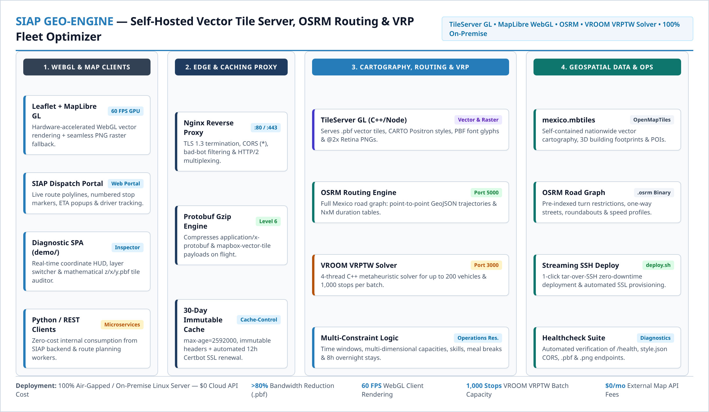
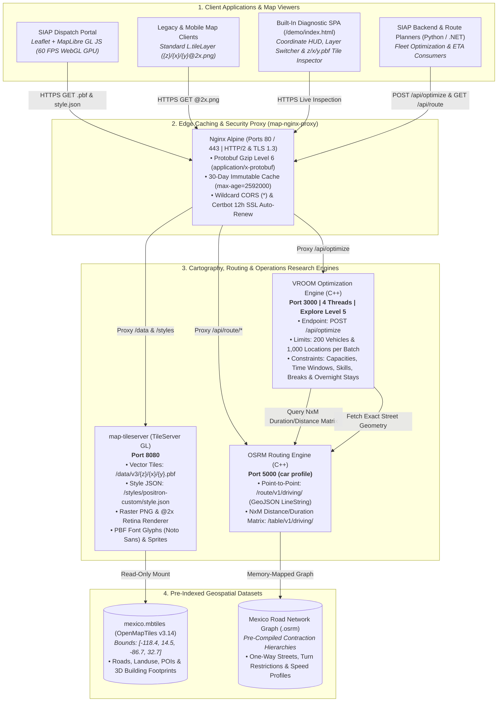
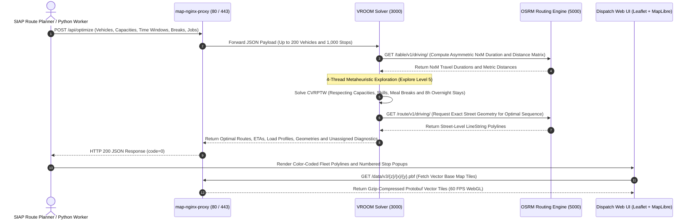

# Self-Hosted Geospatial Vector Tile Server, OSRM Routing & VRP Fleet Optimizer

  

    

      Published
      September 2026
    

    

      Role
      Geospatial Infrastructure &amp; Operations Research Architect
    

    

      Domain
      WebGL Vector Cartography, Street-Level Turn-by-Turn Routing &amp; Capacitated Vehicle Routing Problem with Time Windows (CVRPTW)
    

  

  

    Technology Stack
    

      TileServer GL (C++ / Node)
      OSRM (Open Source Routing Machine)
      VROOM (VRPTW Metaheuristic Solver)
      OpenMapTiles v3.14 (MBTiles / PBF)
      MapLibre GL JS (WebGL 60 FPS)
      Leaflet.js
      Python 3
      Nginx Alpine (Protobuf Gzip &amp; SSL)
      Certbot (Let's Encrypt)
      Docker Compose
    

  

---

## Executive Summary

High-volume last-mile logistics platforms execute tens of thousands of map tile renders, distance matrix calculations, and multi-stop route optimizations every day. Relying on commercial cloud APIs (such as Google Maps Platform or Mapbox) at scale introduces prohibitive per-request billing, strict rate limits, and external network dependencies.

To achieve **100% operational autonomy with $0/month in third-party API fees**, I engineered **`siap-map-server`**: a self-hosted, air-gapped geospatial and route optimization infrastructure running on Docker. The platform integrates four specialized engines behind a hardened **Nginx HTTP/2 reverse proxy**:
1. **TileServer GL** serving compressed **Protocol Buffer Vector Tiles (`.pbf`)** for 60 FPS GPU client rendering alongside `@2x` Retina raster PNG fallbacks across the entire Mexican Republic (`mexico.mbtiles`).
2. **OSRM (Open Source Routing Machine)** computing sub-millisecond street-level trajectories and $N \times M$ travel-time/distance matrices over Mexico's road network.
3. **VROOM** solving multi-vehicle **Capacitated Vehicle Routing Problems with Time Windows (CVRPTW)**, vehicle skills, driver meal breaks, and 8-hour highway overnight stays (*pernoctas*) for up to **200 vehicles and 1,000 stops per batch**.

---

## 1. End-to-End Geospatial & VRP Architecture

The infrastructure decouples heavy cartographic and combinatorial optimization workloads from the core SIAP transactional servers:

---

## 2. Deep-Dive: Core Subsystems & Algorithmic Capabilities

### A. Vector Tile Cartography & Dual WebGL / Raster Rendering (`TileServer GL`)
Traditional raster map servers transmit heavy PNG images for every zoom level and pan action. `siap-map-server` reverses this paradigm by serving **OpenMapTiles v3.14 (`mexico.mbtiles`)** via **TileServer GL**:
* **Vector Tiles (`/data/v3/{z}/{x}/{y}.pbf`):** Delivers compact binary Protocol Buffer tiles compressed on the fly by Nginx (`gzip_comp_level 6` on `application/x-protobuf` and `application/vnd.mapbox-vector-tile`). The client browser's GPU renders streets, labels, and 3D building footprints at **60 FPS** using **MapLibre GL JS** (`@maplibre/maplibre-gl-leaflet`), reducing map bandwidth consumption and HTTP tile count by **over 80%**.
* **CARTO Positron Visual Style & Retina Fallback:** Serves the high-contrast `positron-custom` style (`#fafaf8` bone background, crisp `#dddddd` street casings) so colored fleet polylines stand out clearly. For legacy devices without WebGL, TileServer GL dynamically renders `512px` standard and `@2x` Retina PNG tiles (`maxScaleFactor: 2`, `png: 90`, `webp: 85`).
* **30-Day Immutable Browser Caching:** Nginx attaches `Cache-Control: public, max-age=2592000, immutable` and `Access-Control-Allow-Origin: *`, allowing internal web and mobile clients to cache static cartography locally for 30 days.

### B. Sub-Millisecond Street Routing & $N \times M$ Matrix Computation (`OSRM`)
Powered by **OSRM** compiled against the Mexican national road network (`setup_osrm.sh`), enforcing strict GeoJSON coordinate ordering (`[longitude, latitude]`):
* **Turn-by-Turn Trajectory Service (`GET /api/route/route/v1/driving/{lon1},{lat1};{lon2},{lat2}`):** Respects real-world one-way streets, medians, forbidden left turns, bridges, and roundabouts across Mexico, returning metric distances, travel durations in seconds, maneuver steps (`steps=true`), and full `LineString` GeoJSON geometries (`overview=full&geometries=geojson`).
* **Many-to-Many Distance & Duration Table (`GET /api/route/table/v1/driving/...`):** Computes asymmetric $N \times M$ travel-time (`durations`) and metric distance (`distances`) matrices across hundreds of coordinates in a single HTTP request, feeding the VROOM optimization solver.

### C. Multi-Vehicle Capacitated VRPTW & Overnight Stay Optimizer (`VROOM`)
Configured via `config/vroom.yml` (`threads: 4`, `explore: 5`, `maxlocations: 1000`, `maxvehicles: 200`, `timeout: 300000`), the `POST /api/optimize` endpoint solves complex **Vehicle Routing Problems with Time Windows (VRPTW)**:
* **Multi-Dimensional Capacities & Skills:** Matches vehicle payload limits (`capacity: [weight_kg, volume_m3]`) and equipment tags (`skills: [1, 2]` for refrigerated units or hydraulic liftgates) against customer job requirements (`delivery`, `pickup`, `service` unloading duration, and `priority: 0..100`).
* **Driver Meal Breaks & Multi-Day Highway Overnight Stays (*Pernoctas*):** Supports long-haul inter-city routes by embedding mandatory time-windowed breaks directly into each vehicle's schedule—such as a 45-minute meal window (`service: 2700`) and an 8-hour hotel overnight rest window (`service: 28800` between `22:00` and `06:00`).
* **Closed-Loop vs. Open-Loop Topological Optimization:** Automatically avoids route self-intersections (*criss-cross / bow-tie effects*) and schedules pickups after deliveries so trucks never haul unnecessary weight early in the route.

---

## 3. Built-In Diagnostic SPA (`demo/index.html`) & Streaming Deployment

* **Interactive Cartographic Inspector (`demo/index.html`):** Packaged directly into the repository and served at `/demo`, this zero-dependency Single-Page Application allows engineers to:
  * Hot-swap between **MapLibre GL WebGL Vector**, **Raster Fallback (`{z}/{x}/{y}.png`)**, and **OSM** layers in real time.
  * Audit live cursor coordinates via a floating **Geocoordinate HUD** and jump instantly between Mexican logistics hubs (Guadalajara SIAP Base, CDMX, Monterrey, Queretaro, Tijuana).
  * Mathematically compute and inspect the exact `z/x/y.pbf` vector tile under the viewport crosshair with 1-click download auditing.
* **Zero-Downtime Streaming SSH Deployment (`deploy.sh` & `scripts/healthcheck.sh`):**
  * Streams configuration updates over SSH (`tar -czf - . | ssh ...`), pulls container updates, provisions Let's Encrypt RSA certificates (`ISRG Root X1` chain), and hot-reloads Nginx (`nginx -s reload`) without dropping active map sessions.
  * Includes an automated verification script (`scripts/healthcheck.sh`) validating HTTP 200 responses, CORS headers, `application/x-protobuf` vector delivery, and `image/png` raster fallbacks.

---

## 4. Infrastructure & Endpoint Matrix

| Subsystem / Endpoint | Method & Path | Content-Type / Output | Primary Purpose |
| :--- | :--- | :--- | :--- |
| **Vector Style Specification** | `GET /styles/positron-custom/style.json` | `application/json` | MapLibre GL / WebGL style definition with CORS (`*`) |
| **Protobuf Vector Tiles** | `GET /data/v3/{z}/{x}/{y}.pbf` | `application/x-protobuf` | Gzip-compressed vector geometry rendered at 60 FPS on client GPU |
| **Retina Raster Fallback** | `GET /styles/positron-custom/{z}/{x}/{y}@2x.png` | `image/png` | Server-rendered `512px` high-DPI tiles for standard `L.tileLayer` |
| **Point-to-Point Routing** | `GET /api/route/route/v1/driving/{lon},{lat};...` | `application/json` (GeoJSON) | Street-level trajectory, metric distance, duration & turn maneuvers |
| **$N \times M$ Distance Matrix** | `GET /api/route/table/v1/driving/{lon},{lat};...` | `application/json` | Asymmetric travel time and distance matrix across multiple stops |
| **VRPTW Fleet Optimizer** | `POST /api/optimize` | `application/json` | Multi-vehicle route sequencing with time windows, capacities & breaks |
| **Diagnostic Inspector** | `GET /demo` & `GET /health` | `text/html` / `application/json` | Live WebGL/Raster tester, tile coordinate auditor & liveness probe |

---

## 5. Key Engineering Outcomes & Metrics

* **Over 80% Bandwidth Reduction:** Replacing raster PNG tile streams with Gzip-compressed `.pbf` Vector Tiles and 30-day immutable browser caching drastically reduced network egress and accelerated map rendering to 60 FPS via WebGL.
* **$0/Month Cloud API Cost:** Running `TileServer GL`, `OSRM`, and `VROOM` 100% on-premise eliminated recurring commercial geocoding, matrix, and routing API bills across thousands of daily shipments.
* **High-Capacity Fleet Optimization:** Capable of optimizing up to **200 heterogeneous vehicles and 1,000 delivery/pickup stops** in a single batch while enforcing real-world Mexican street topology, time windows, and driver rest regulations.
