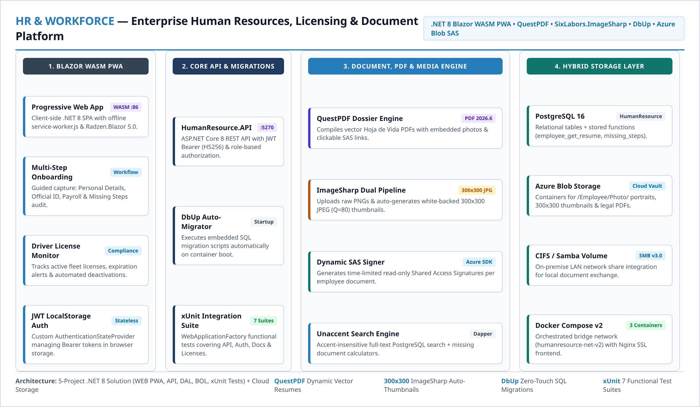
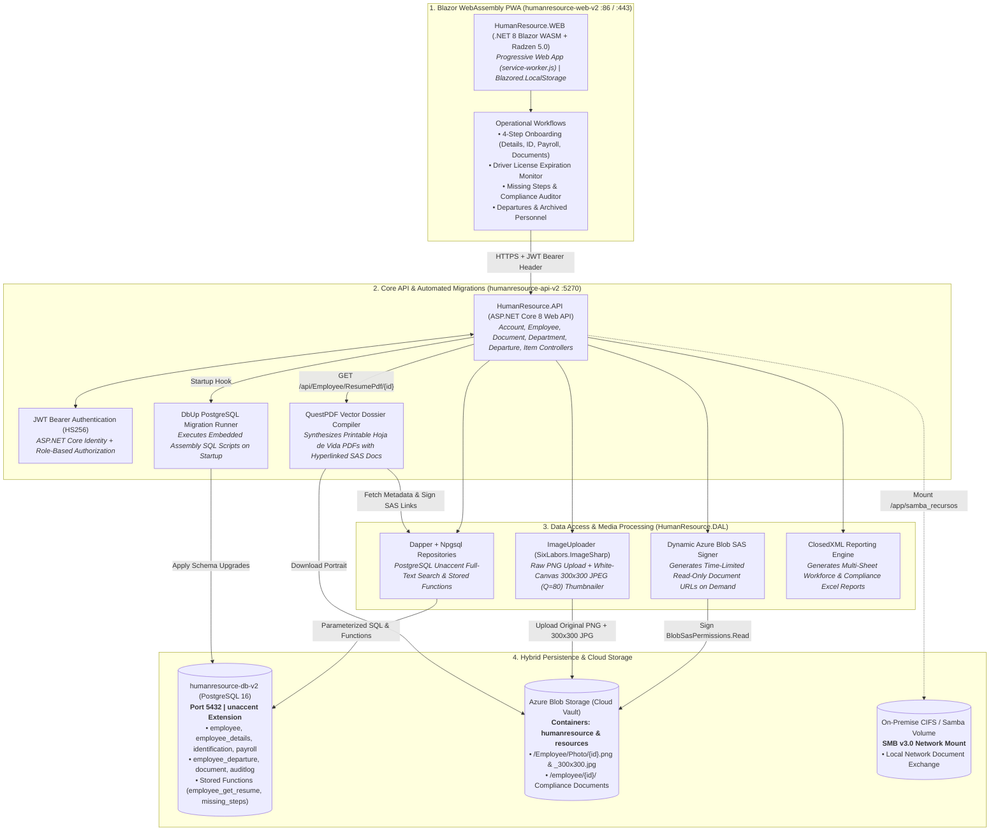
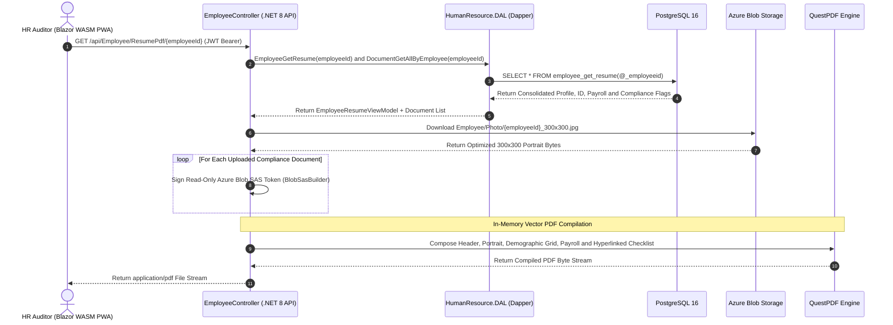

<style>
.project-meta-card {
   background: #f8fafc;
   border: 1px solid #e2e8f0;
   border-left: 4px solid #267CB9;
   border-radius: 6px;
   padding: 16px 18px;
   margin: 16px 0 24px 0;
   font-family: "Noto Sans", "Helvetica Neue", Helvetica, Arial, sans-serif;
}
.project-meta-grid {
   display: grid;
   grid-template-columns: repeat(auto-fit, minmax(180px, 1fr));
   gap: 12px 20px;
   padding-bottom: 12px;
   border-bottom: 1px solid #e2e8f0;
   margin-bottom: 12px;
}
.project-meta-item {
   display: flex;
   flex-direction: column;
}
.project-meta-item.full-width {
   grid-column: 1 / -1;
}
.project-meta-label {
   font-size: 10.5px;
   font-weight: 700;
   text-transform: uppercase;
   letter-spacing: 0.06em;
   color: #267CB9;
   margin-bottom: 3px;
}
.project-meta-value {
   font-size: 13.5px;
   color: #222222;
   font-weight: 400;
   line-height: 1.4;
}
.project-stack-list {
   display: flex;
   flex-wrap: wrap;
   gap: 6px;
   margin-top: 6px;
}
.tech-badge {
   display: inline-block;
   background: #ffffff;
   color: #267CB9;
   border: 1px solid #bcd6eb;
   border-radius: 4px;
   padding: 2px 9px;
   font-size: 12px;
   font-weight: 400;
   line-height: 1.5;
}
</style>

# Enterprise HR, Fleet Licensing & Document Compliance Platform

<div class="project-meta-card">
  <div class="project-meta-grid">
    <div class="project-meta-item">
      <span class="project-meta-label">Published</span>
      <span class="project-meta-value">July 2024</span>
    </div>
    <div class="project-meta-item">
      <span class="project-meta-label">Role</span>
      <span class="project-meta-value">Lead .NET Full-Stack Architect</span>
    </div>
    <div class="project-meta-item full-width">
      <span class="project-meta-label">Domain</span>
      <span class="project-meta-value">Workforce Lifecycle Management, Fleet Driver License Auditing, Cloud Document Vault &amp; Automated PDF Dossiers</span>
    </div>
  </div>
  <div class="project-meta-item">
    <span class="project-meta-label">Technology Stack</span>
    <div class="project-stack-list">
      <span class="tech-badge">.NET 8 Core (C#)</span>
      <span class="tech-badge">Blazor WebAssembly (PWA)</span>
      <span class="tech-badge">Radzen.Blazor 5.0</span>
      <span class="tech-badge">ASP.NET Core 8 Web API</span>
      <span class="tech-badge">QuestPDF</span>
      <span class="tech-badge">SixLabors.ImageSharp</span>
      <span class="tech-badge">Dapper &amp; Npgsql</span>
      <span class="tech-badge">DbUp (PostgreSQL Migrations)</span>
      <span class="tech-badge">PostgreSQL 16</span>
      <span class="tech-badge">Azure Blob Storage (SAS)</span>
      <span class="tech-badge">xUnit &amp; WebApplicationFactory</span>
      <span class="tech-badge">Docker &amp; Nginx</span>
    </div>
  </div>
</div>



---

## Executive Summary

Logistics and transportation companies face strict regulatory and operational compliance requirements for their workforce: tracking multi-stage employee onboarding, auditing driver license expiration dates across active fleet operators, securing sensitive personal identification documents, and generating standardized employee dossiers (*Hojas de Vida*).

To centralize and automate these workflows at enterprise scale, I designed and built an **Enterprise Human Resources & Compliance Platform**: a 5-project **.NET 8** solution combining a **Blazor WebAssembly Progressive Web App (`HumanResource.WEB`)**, a **RESTful Backend API (`HumanResource.API`)**, a **Dapper + Azure Blob Storage Data Layer (`HumanResource.DAL`)**, a shared **Business Object Layer (`HumanResource.BOL`)**, and an **automated `xUnit` integration test suite (`HumanResource.Tests`)**. The platform features zero-touch **DbUp** SQL migrations, automatic **SixLabors.ImageSharp** dual-resolution portrait processing, time-limited **Azure Blob SAS** document links, and real-time **QuestPDF** dossier generation with clickable cloud verification links.

---

## 1. System Architecture & 5-Project .NET 8 Topology

The ecosystem is orchestrated via Docker Compose (`humanresource-net-v2`) separating the static Blazor WebAssembly SPA container (`humanresource-web-v2`), the .NET 8 API container (`humanresource-api-v2`), PostgreSQL 16 (`humanresource-db-v2`), Azure Blob Storage, and on-premise CIFS/Samba network volumes:



---

## 2. Deep-Dive: Engineering Innovations & Workflows

### A. Multi-Stage Onboarding & Compliance Auditing (`MissingSteps` & `MissingDocuments`)
Onboarding logistics personnel requires capturing four distinct data domains: **Core Profile (`Employee`)**, **Demographic Details (`EmployeeDetails`)**, **Official Government IDs (`EmployeeIdentification`: CURP, RFC, NSS, INFONAVIT)**, **Payroll & Banking (`EmployeePayroll`)**, and **Mandatory Digital Documents (`Document`)**.
* To prevent incomplete hiring records from slipping into active operations, I engineered PostgreSQL stored functions (`employee_get_missing_steps()`, `employee_get_missing_steps_byid(@_employeeid)`, and `DocumentGetAllMissingByID`) that evaluate every active employee (`LEFT JOIN employee_departure d ON e.employeeid = d.employeeid WHERE d.employeeid IS NULL`) and return real-time completion checklists to the Blazor dashboard.
* **Driver License Expiration Auditing:** Dedicated endpoints and Blazor views (`LicenseShowAll`, `LicenseExpiringSoon`, `LicenseAdd`, `LicenseDeactivate`) track commercial driver licenses across the fleet, alerting HR before an operator's license expires.

### B. Dual-Resolution Portrait Pipeline (`SixLabors.ImageSharp` + Azure Blob Storage)
Employee ID photos uploaded during onboarding are often multi-megabyte PNGs with transparent or inconsistent backgrounds, which slow down directory grids and PDF generation.
* In `ImageUploader.cs`, every uploaded portrait undergoes an automated two-stage in-memory pipeline using **SixLabors.ImageSharp**:
  1. **Archival Master Upload:** Streams the raw byte array to Azure Blob Storage at `Employee/Photo/{EmployeeID}.png` (`image/png`).
  2. **White-Canvas Thumbnail Synthesis:** Loads the image into memory, composites transparent pixels over a solid white background (`ctx.BackgroundColor(Color.White)` to prevent black artifacts during JPEG conversion), center-crops to `300x300` (`ResizeMode.Crop`), encodes with `JpegEncoder { Quality = 80 }`, and uploads `Employee/Photo/{EmployeeID}_300x300.jpg` (`image/jpeg`).

### C. Vector PDF Dossier Generation with Hyperlinked Cloud Evidence (`QuestPDF`)
Instead of relying on slow HTML-to-PDF browser wrappers, `EmployeeController` uses **QuestPDF (`2026.6.1`)** to compile structured *Hoja de Vida* employee dossiers in milliseconds:
* Queries PostgreSQL stored functions (`employee_get_resume`) alongside the employee's uploaded digital documents (`DAL.Document.DocumentGetAllByEmployee(id)`).
* Dynamically generates time-limited **Azure Blob SAS URLs** for each verified document (`doc.Exist == true`) and embeds them directly into the PDF checklist table using `cell.Hyperlink(sasUrl)`, allowing auditors viewing the PDF to open original cloud certificates with a single click.



### D. Accent-Insensitive Search & Zero-Touch DbUp Migrations
* **Accent-Insensitive PostgreSQL Search:** Mexican names and addresses frequently contain diacritics (*Hernández*, *Gómez*, *León*). `EmployeeSearch` leverages PostgreSQL's `unaccent` extension combined with `ILIKE` so operators can search seamlessly regardless of accent marks:
  ```sql
  SELECT e.employeeid, e.employeename, e.lastname, e.birthdate, e.phonenumber, e.address, e.maritalstatus, e.gender
  FROM employee e
  LEFT JOIN employee_departure d ON e.employeeid = d.employeeid
  WHERE d.employeeid IS NULL AND (
      e.employeeid LIKE @_query OR
      unaccent(e.employeename || ' ' || e.lastname) ILIKE unaccent(@_query) OR
      e.phonenumber LIKE @_query
  );
  ```
* **Automated DbUp Migrations (`Program.cs`):** SQL migration scripts inside `HumanResource.API/Scripts/*.sql` are compiled as `EmbeddedResource` artifacts. On application startup, **DbUp (`dbup-postgresql`)** inspects the target PostgreSQL schema and applies pending migrations transactionally before Kestrel begins accepting traffic.
* **Automated Functional & Integration Testing (`HumanResource.Tests`):** Built with **xUnit (`2.6.2`)** and `Microsoft.AspNetCore.Mvc.Testing` (`WebApplicationFactory`), executing 7 end-to-end test suites (`ApiEndpointsIntegrationTests`, `AccountFunctionalTests`, `DepartmentFunctionalTests`, `DocumentFunctionalTests`, `EmployeeLicenseFunctionalTests`, `EmployeeReportFunctionalTests`, and `EmployeeSearchFunctionalTests`).

---

## 3. Architecture & Component Matrix

| Component / Project | Technology | Port / Role | Core Responsibilities |
| :--- | :--- | :---: | :--- |
| **`HumanResource.WEB`** | .NET 8 Blazor WebAssembly + Radzen 5.0 + Nginx | `86` / `443` | Offline-ready PWA (`service-worker.js`), onboarding wizard, license & compliance dashboards |
| **`HumanResource.API`** | ASP.NET Core 8 Web API + Identity + QuestPDF | `5270:8080` | JWT (`HS256`) auth, REST controllers, QuestPDF resume synthesis, DbUp auto-migration |
| **`HumanResource.DAL`** | Dapper + Npgsql + ImageSharp + ClosedXML | *Data Layer* | Stored function execution, `unaccent` search, `300x300` JPEG thumbnailing, Excel exports |
| **`HumanResource.BOL`** | .NET 8 Class Library | *Domain Layer* | Entities (`Employee`, `Document`, `Departure`), DTOs, Mexican state enums & compliance helpers |
| **`HumanResource.Tests`** | xUnit + `Microsoft.AspNetCore.Mvc.Testing` | *Test Suite* | 7 automated functional and integration test suites validating API contracts and business rules |
| **`humanresource-db-v2`** | PostgreSQL 16 | `5432:5432` | Relational HR ledger, departure soft-deletion filtering, stored procedures & audit logs |

---

## 4. Key Engineering Outcomes

* **100% Onboarding & License Visibility:** Automated missing-step and missing-document stored procedures eliminated manual HR audits and prevented drivers with expired licenses from being dispatched.
* **Sub-Second Vector Dossier Generation:** Replacing legacy report builders with **QuestPDF** and pre-resized `300x300` **ImageSharp** thumbnails reduced *Hoja de Vida* PDF compilation time to milliseconds while keeping file sizes compact.
* **Zero-Exposure Cloud Document Security:** Sensitive employee files remain private inside Azure Blob Storage and are accessed exclusively via ephemeral, read-only **SAS tokens** signed on demand.
* **Continuous Regression Safety:** The 7-suite **xUnit + WebApplicationFactory** test harness verifies authentication, license expiration rules, document uploads, and search queries prior to deployment.
