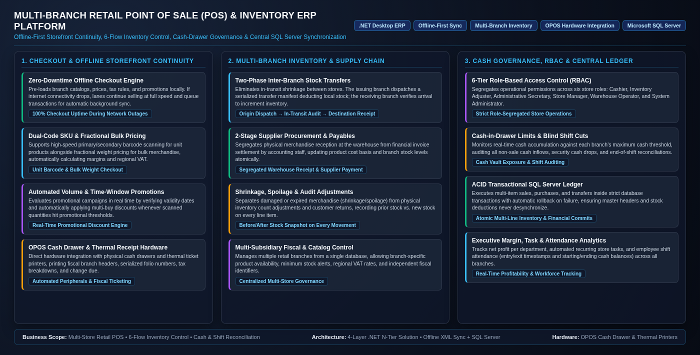
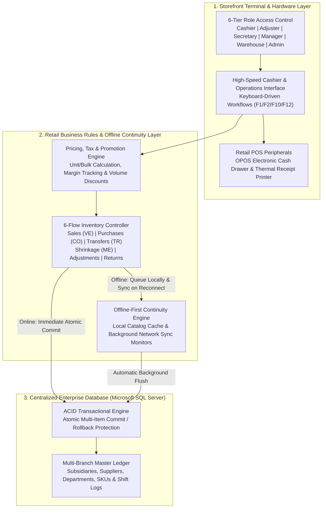
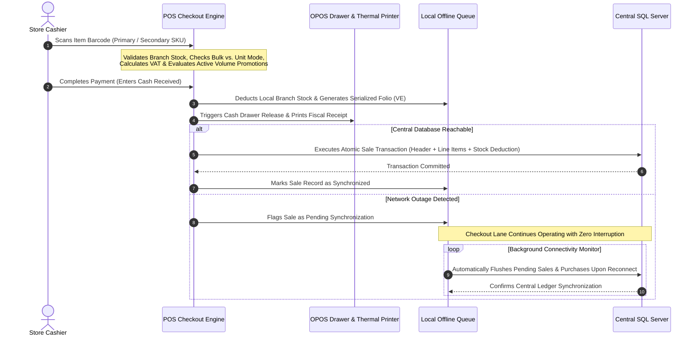
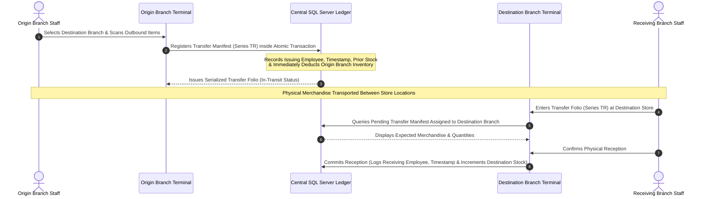

# Multi-Branch Retail Point of Sale (POS), Offline Storefront & Inventory ERP Platform

  

    

      Published
      November 2020
    

    

      Role
      Lead Software Architect &amp; Systems Developer
    

    

      Domain
      Multi-Store Retail Operations, Offline-First POS Checkout, Supply Chain Inventory Control &amp; Cash-Vault Auditing
    

  

  

    Technology Stack
    

      .NET Desktop ERP (4-Tier Architecture)
      Microsoft SQL Server
      Offline-First XML Sync Engine
      OPOS Cash Drawer &amp; Thermal Printers
      Multi-Branch Inventory Governance
      6-Role Access Control (RBAC)
    

  

---

## Executive Summary

Designed and deployed for multi-branch retail operations, this **Point of Sale (POS) and Inventory ERP Platform** solves the three biggest operational risks in physical retail: **checkout downtime during internet outages**, **inventory shrinkage across store transfers and warehouse reception**, and **cash-drawer discrepancies across cashier shifts**.

Engineered on a decoupled 4-tier **.NET** architecture backed by **Microsoft SQL Server** and a **local offline synchronization engine**, the platform allows every branch terminal to operate at 100% speed without network dependency while enforcing centralized financial governance, automated volume promotions, two-phase inter-store inventory transfers, and direct hardware control over physical cash drawers and thermal receipt printers.

---

## 1. Core Retail Business Problems Solved

Physical retail chains operating across multiple locations face constant friction between **checkout speed at the counter** and **strict accounting and inventory control at headquarters**. This platform resolves five critical business challenges:

### 1.1 Zero-Downtime Storefront Continuity (Offline-First Synchronization)
In traditional cloud-dependent POS systems, an internet outage immediately halts checkout lanes, resulting in lost revenue and abandoned baskets. To guarantee **100% storefront availability**:
- **Local Branch Catalog & Pricing Cache**: Each terminal maintains a synchronized local snapshot of its branch-specific product catalog, tax rules, active promotions, and sequential folio counters.
- **Uninterrupted Offline Checkout**: When a sale, supplier reception, or shrinkage record is completed during a network outage, the terminal immediately deducts local inventory, opens the physical cash drawer, prints the customer receipt, and stores the transaction in a local pending queue.
- **Autonomous Background Reconciliation**: Background network monitors continuously detect when connectivity to the central SQL Server database is restored and automatically synchronize all pending sales, purchases, and cash movements without cashier intervention.

### 1.2 Full-Lifecycle Inventory Governance (6 Audited Movement Flows)
Uncontrolled stock adjustments are a primary source of retail shrinkage ("robo hormiga" and administrative loss). Instead of allowing arbitrary stock edits, the platform enforces **six distinct, serialized movement workflows**, each recording the responsible employee, timestamp, branch folio, and the exact **prior stock vs. new stock** snapshot on every line item:
1. **Retail Checkout Sales (`VE` Series)**: Real-time stock deduction for inventory-tracked items, capturing unit sale price, supplier cost basis (for net margin calculation), tax breakdown, and Applied discounts.
2. **Two-Phase Inter-Branch Merchandise Transfers (`TR` Series)**: Eliminates stock lost in transit between stores. The origin branch issues a serialized transfer manifest (`TR`) that immediately deducts local stock; the receiving branch must scan and validate that exact transfer folio upon physical arrival to increment its local stock, logging both the issuing and receiving staff members.
3. **Two-Stage Supplier Procurement (`CO` Series)**: Enforces segregation of duties by separating **physical warehouse reception** (performed by warehouse staff upon supplier delivery, immediately updating stock and cost basis) from **financial invoice settlement** (performed subsequently by administrative/accounting staff).
4. **Shrinkage & Spoilage Control (`ME` Series - Merma)**: Isolates damaged, expired, or spoiled merchandise from general inventory adjustments so management can measure true operational waste per store and department.
5. **Physical Audit Adjustments**: Reconciles physical shelf counts against system inventory under restricted adjuster credentials.
6. **Customer Merchandise Returns**: Processes post-sale product returns with full folio traceability.

### 1.3 Dual-Presentation Checkout & Automated Promotional Engine
Retail stores sell a mix of pre-packaged barcode items and fractional bulk goods, often subject to complex seasonal promotions:
- **Unit SKU & Bulk Weight (`Granel`) Support**: Cashiers scan primary or secondary barcodes for standard unit items, while bulk goods automatically trigger a fractional weight/quantity calculator that computes proportional pricing and inventory deduction.
- **Automated Time-Window & Volume Promotions**: Rather than allowing cashiers to manually type arbitrary discounts at the register, promotional rules are configured centrally with **start/end validity dates** and **volume thresholds** (e.g., multi-buy bundle discounts). During checkout, the engine automatically evaluates active campaigns and applies the exact promotional deduction when the scanned quantity meets the campaign multiple.

### 1.4 Cash-Drawer Security, Maximum Vault Thresholds & Shift Reconciliation
Managing physical cash across multiple shifts requires strict hardware and procedural controls:
- **Per-Branch Maximum Cash-in-Drawer Limits**: Each branch defines a maximum allowable cash threshold in the register. The system tracks cumulative cash sales plus non-sale cash inflows (`Entradas de Dinero` / change funds) minus security cash drops (`Salidas de Dinero` / vault skims) to alert staff when a security drop is required.
- **Hardware-Enforced Cash Drawer Access**: Physical cash drawers (connected via **OPOS / Microsoft Point of Service**) remain locked and only trigger an electronic release pulse upon authorized sale completion or authenticated cash entry/exit events.
- **Shift Handover & Blind Cash Cuts (`Corte de Caja`)**: Tracks employee shift logins and logouts—recording entry/exit timestamps and starting/ending drawer balances—and generates comprehensive departmental and item-level sales reports.

### 1.5 Multi-Subsidiary Fiscal & Operational Administration
A single enterprise database governs multiple physical store branches (`Subsidiaries`), where each branch independently configures:
- Commercial store name, legal tax address, and corporate tax identifier (RFC) printed dynamically on thermal receipts.
- Regional VAT (`IVA`) applicability and tax extraction rules.
- Branch-specific product availability, minimum stock reorder thresholds, and scheduled operational tasks (daily, weekly, or monthly store routines).

---

## 2. End-to-End Operational Architecture

The following diagram illustrates how the storefront terminal, hardware peripherals, local offline resilience engine, and centralized SQL Server database interact across the four architectural layers:

---

## 3. Critical Business Workflows

### 3.1 Offline-Resilient Checkout & Autonomous Synchronization Flow

### 3.2 Two-Phase Inter-Branch Merchandise Transfer Flow

To prevent inventory loss when moving merchandise between store locations, stock is never adjusted in a single unverified step:

---

## 4. Role-Based Governance & Operational Segregation of Duties

To protect store assets and prevent internal fraud, the platform enforces a strict **6-level access hierarchy**, ensuring employees only interact with the modules required by their operational role:

| Store Role | Authorized Operational Scope | Financial & Inventory Risk Controls |
| :--- | :--- | :--- |
| **1. Cashier (`Cajero`)** | High-speed checkout (`Ventas`), barcode lookup, cash entry/exit registration, and shift handover (`Fin de Turno`). | Cannot modify product prices, alter historical stock counts, or approve supplier invoices. |
| **2. Inventory Adjuster (`Ajustador`)** | Physical stock audits (`Ajustes`) and shrinkage/spoilage registration (`Merma`). | Every adjustment records the adjuster's identity and snapshots prior stock vs. adjusted stock. |
| **3. Warehouse Operator (`Almacenista`)** | Physical supplier merchandise reception (`Compras`), outbound/inbound inter-branch transfers (`Transferencias`). | Can receive physical stock into the warehouse but cannot mark supplier invoices as financially paid. |
| **4. Administrative Secretary (`Secretaria`)** | Supplier directory management, department administration, and supplier invoice payment settlement. | Segregates accounts-payable disbursement from physical warehouse reception. |
| **5. Store Manager (`Gerente`)** | Promotional discount configuration, recurring store tasks, cash cuts (`Corte de Caja`), and inventory reporting. | Full visibility into branch profitability, cashier shift discrepancies, and minimum stock alerts. |
| **6. System Administrator (`Admin`)** | Multi-branch (`Subsidiary`) fiscal setup, employee credential provisioning, and global system parameters. | Central governance over all retail locations, tax rates, and security thresholds. |

---

[Back to Portfolio](../../index.md)
