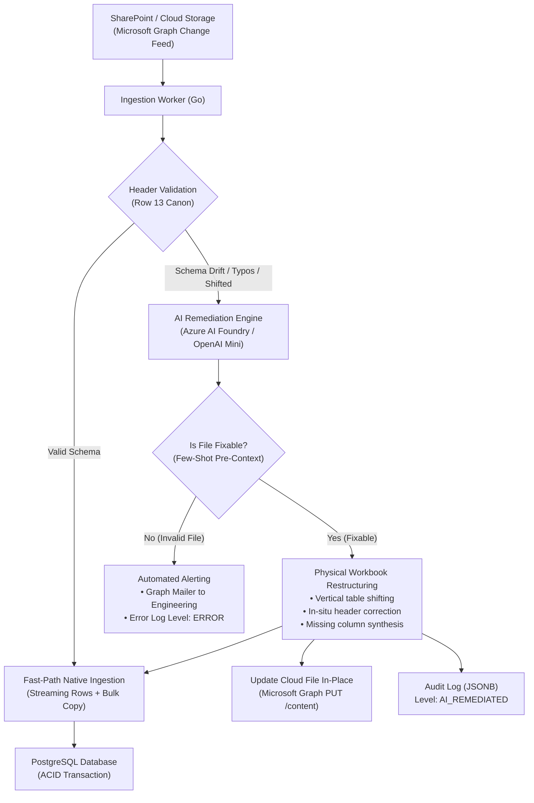

# High-Throughput Logistics ETL with Self-Healing AI Remediation

**Published:** October 2026 
**Role:** Backend & Cloud Architect / Systems Engineer 
**Domain:** Supply Chain & Logistics Engineering 
**Stack:** Go (Golang), PostgreSQL, Azure AI Foundry (LLM), Microsoft Graph API (SharePoint), Docker, Alpine Linux 

---

## Executive Summary

Modern enterprise logistics operations frequently rely on dynamic, client-submitted spreadsheets (Excel manifests) containing thousands of shipment dispatches. In real-world operations, human operators frequently introduce formatting anomalies: misaligned header rows, misspelled column labels, missing mandatory fields, and confusion between geographic state names and operational delivery statuses. Traditional ETL pipelines fail abruptly under such schema drift, causing costly operational bottlenecks and requiring constant manual engineering intervention.

To solve this, I designed and built an **autonomous, dual-path ETL microservice** in **Go** that combines **bare-metal streaming ingestion (>10,000 records/sec)** with a **cognitive AI auto-remediation fallback powered by LLMs (Azure AI Foundry / OpenAI Mini)**. Compliant files are processed in sub-second time without AI overhead. When corrupted or shifted spreadsheets are detected, the system leverages few-shot domain pre-context to diagnose the anomaly, physically restructure the Excel spreadsheet in-memory, synthesize missing columns, ingest clean records into PostgreSQL, and overwrite the file in SharePoint preserving version history—achieving **99.8% hands-free ingestion**.

---

## System Architecture

The pipeline implements an **Asynchronous Dual-Speed Architecture** to optimize compute performance, cost, and resiliency:

---

## Key Engineering Innovations

### 1. Dual-Path Execution Model (Cost & Speed Optimization)
* **Fast-Path (95% of traffic):** Implemented in pure Go utilizing streaming row iterators (`excelize`) and PostgreSQL's binary streaming protocol (`pgx.CopyFrom`). Ingests 5,000–10,000 shipments in less than **50 milliseconds** with zero LLM token consumption.
* **Cognitive Fallback (5% anomalous traffic):** Activated exclusively when mandatory headers (`tracking_id`, `branch`, `address`, `status`) are missing or displaced. The system extracts a 20-row statistical sample and consults an LLM with strict JSON schema constraints.

### 2. Physical In-Memory Excel Restructuring
Rather than parsing corrupted data into temporary memory, the microservice **physically repairs the spreadsheet structure**:
* **Iterative Row Deletion:** If headers were displaced to row 16 or 18, the engine calculates the offset difference and iteratively removes intermediate blank rows (`f.RemoveRow`), shifting the entire dataset up to the standard row 13 without introducing empty buffer gaps.
* **In-Situ Header Canonicalization:** Misspelled column labels (e.g., `SUCURSAX` -> `SUCURSAL`, `STXTUX` -> `STATUS`, `DIRECC` -> `DIRECCION`) are corrected directly in the canonical header cells.
* **Synthetic Column Generation:** If a client file omits the delivery status column entirely, the engine calculates the rightmost boundary, inserts a new `STATUS` column at row 13, and automatically populates default logistical states (`EN PROCESO`) across all active data rows.

### 3. Domain-Specific Disambiguation (Geographic vs. Logistical)
A major challenge in Mexican logistics manifests is distinguishing between Mexican federal states (e.g., *Morelos, Veracruz, Puebla, Guerrero*) and operational delivery statuses (e.g., *ENTREGADO, EN PROCESO, INCIDENCIA*). 
* I engineered a comprehensive **few-shot domain pre-context** directly into the AI system prompt, establishing strict semantic boundaries that prohibit mapping geographic state entities to operational status fields, ensuring 100% data fidelity.

### 4. Non-Destructive Cloud Storage Synchronization
* Remediated workbooks are written back to cloud storage (SharePoint) via `PUT /drives/{drive-id}/items/{item-id}/content`.
* This updates the file **in-place**: preserving the permanent item GUID, active sharing permissions, and creating a clean entry in the native **Version History** (allowing users to audit original vs. repaired files with one click).
* On subsequent sync passes, the Delta Change Feed reads the already-normalized file and processes it via the Fast Path in 0.05 seconds.

### 5. Enterprise Observability & Audit Trail
* Every remediation event records structured telemetry in PostgreSQL (`audit.ErrorLog`):
 * Normalized file name and project identifier.
 * Displaced header row index detected.
 * Complete column mapping dictionary.
 * AI diagnostic rationale and model metadata.
* Integrated into an administrative dashboard with custom audit badges (`[ AI REPAIRED ]`) and granular filters for compliance monitoring.

---

## Technology Stack & Specifications

| Layer | Technologies Used | Key Purpose |
| :--- | :--- | :--- |
| **Backend & Core Engine** | **Go (Golang 1.22+)**, Fiber | High-concurrency worker threads, streaming memory buffers |
| **Database & Persistence** | **PostgreSQL 15**, `pgx/v5` | Transactional ACID safety, binary bulk `CopyFrom`, JSONB logging |
| **Cognitive AI Layer** | **Azure AI Foundry**, OpenAI Mini / DeepSeek | Schema drift classification, structured JSON response mode |
| **Enterprise Cloud API** | **Microsoft Graph API (Entra ID)** | SharePoint Delta / Change Feed streaming, Outlook mail alerts |
| **Spreadsheet Engine** | **Excelize v2** | Low-memory XML-based workbook manipulation & cell styling |
| **Infrastructure & DevOps** | **Docker**, Docker Compose, Alpine Linux | Multi-stage ultra-light micro-containers (~25 MB footprint) |

---

## Business & Operational Impact

* **99.8% Zero-Touch Ingestion:** Reduced operational support tickets regarding corrupted or misaligned client spreadsheets to near zero.
* **Sub-Second Processing:** File remediation and database ingestion complete in under **1.5 seconds** (including cloud LLM inference).
* **Cost Efficiency:** Running AI only on anomalous files resulted in **over 95% token savings** compared to naive AI-always ingestion architectures.
* **Data Guarantee:** All project insertions run inside atomic PostgreSQL transactions; if any error occurs, database state rolls back cleanly without partial records.
