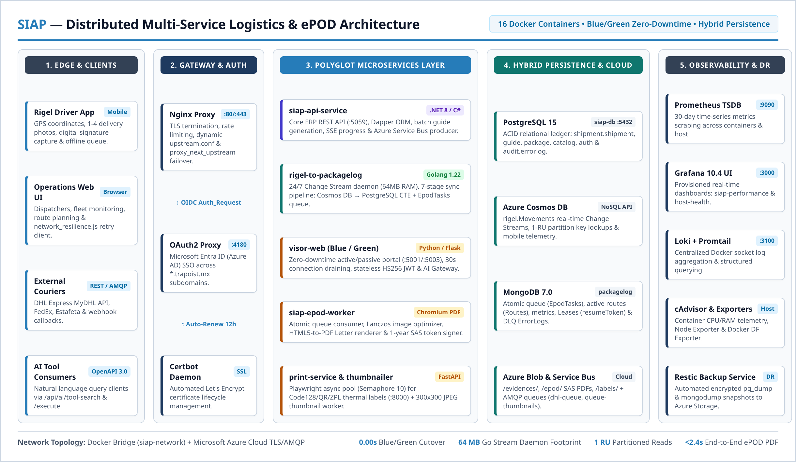
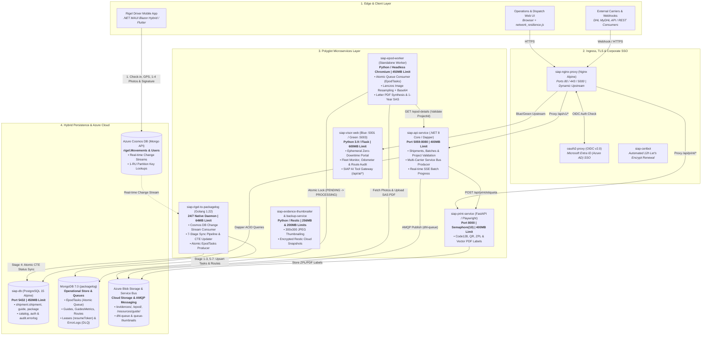
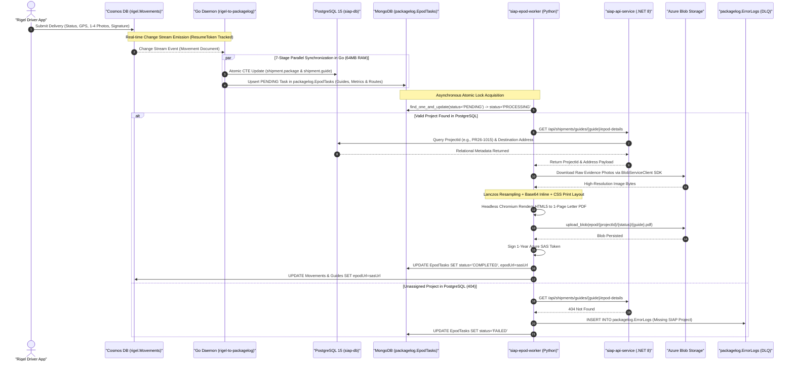
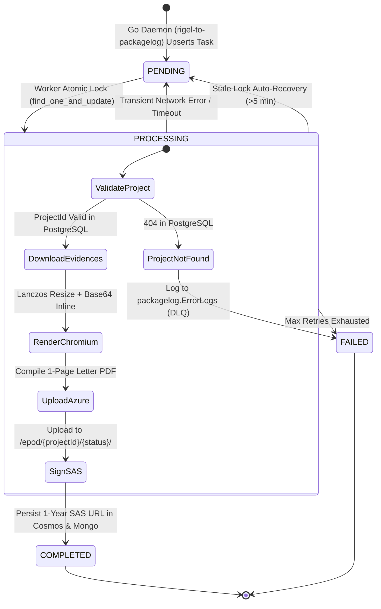

<style>
.project-meta-card {
   background: #f8fafc;
   border: 1px solid #e2e8f0;
   border-left: 4px solid #267CB9;
   border-radius: 6px;
   padding: 16px 18px;
   margin: 16px 0 24px 0;
   font-family: "Noto Sans", "Helvetica Neue", Helvetica, Arial, sans-serif;
}
.project-meta-grid {
   display: grid;
   grid-template-columns: repeat(auto-fit, minmax(180px, 1fr));
   gap: 12px 20px;
   padding-bottom: 12px;
   border-bottom: 1px solid #e2e8f0;
   margin-bottom: 12px;
}
.project-meta-item {
   display: flex;
   flex-direction: column;
}
.project-meta-item.full-width {
   grid-column: 1 / -1;
}
.project-meta-label {
   font-size: 10.5px;
   font-weight: 700;
   text-transform: uppercase;
   letter-spacing: 0.06em;
   color: #267CB9;
   margin-bottom: 3px;
}
.project-meta-value {
   font-size: 13.5px;
   color: #222222;
   font-weight: 400;
   line-height: 1.4;
}
.project-stack-list {
   display: flex;
   flex-wrap: wrap;
   gap: 6px;
   margin-top: 6px;
}
.tech-badge {
   display: inline-block;
   background: #ffffff;
   color: #267CB9;
   border: 1px solid #bcd6eb;
   border-radius: 4px;
   padding: 2px 9px;
   font-size: 12px;
   font-weight: 400;
   line-height: 1.5;
}
</style>

# SIAP: Distributed Multi-Service Logistics & Last-Mile Delivery Platform

<div class="project-meta-card">
  <div class="project-meta-grid">
    <div class="project-meta-item">
      <span class="project-meta-label">Published</span>
      <span class="project-meta-value">November 2026</span>
    </div>
    <div class="project-meta-item">
      <span class="project-meta-label">Role</span>
      <span class="project-meta-value">Lead Backend Architect &amp; Systems Engineer</span>
    </div>
    <div class="project-meta-item full-width">
      <span class="project-meta-label">Domain</span>
      <span class="project-meta-value">Supply Chain, Last-Mile Logistics, Multi-Carrier Dispatch &amp; Electronic Proof of Delivery (ePOD)</span>
    </div>
  </div>
  <div class="project-meta-item">
    <span class="project-meta-label">Technology Stack</span>
    <div class="project-stack-list">
      <span class="tech-badge">.NET 8 Core (C# / Dapper)</span>
      <span class="tech-badge">Golang 1.22</span>
      <span class="tech-badge">Python (Flask &amp; FastAPI)</span>
      <span class="tech-badge">PostgreSQL 15</span>
      <span class="tech-badge">Azure Cosmos DB</span>
      <span class="tech-badge">MongoDB 7.0</span>
      <span class="tech-badge">Azure Service Bus</span>
      <span class="tech-badge">Azure Blob Storage (SAS)</span>
      <span class="tech-badge">Microsoft Entra ID (OAuth2)</span>
      <span class="tech-badge">Playwright &amp; Headless Chromium</span>
      <span class="tech-badge">Docker (16 Containers)</span>
      <span class="tech-badge">Nginx (Blue/Green)</span>
      <span class="tech-badge">Prometheus, Grafana &amp; Loki</span>
    </div>
  </div>
</div>



---

## Executive Summary

Enterprise last-mile logistics and parcel operations require real-time visibility across thousands of active shipments, asynchronous multi-carrier integration (DHL Express, FedEx, Estafeta), and immediate synthesis of legally binding digital delivery receipts (**ePOD - Electronic Proof of Delivery**). Field drivers operating the **Rigel** mobile app continuously submit GPS coordinates, 1 to 4 high-resolution delivery photos, and digital recipient signatures across variable cellular networks.

To support these operations for **TraPoist** without bottlenecks or downtime, I architected and engineered **SIAP** (*Sistema Integral de Administracion de Paqueteria*): a 16-container polyglot microservices ecosystem orchestrated on Docker (`siap-network`) and Microsoft Azure. The architecture decouples core transactional ERP operations (**.NET 8 Core**), 24/7 database Change Stream synchronization (**Golang 1.22**), ephemeral Blue/Green web portals (**Python / Flask**), and headless document/label synthesis (**FastAPI / Playwright / Chromium**) over a hybrid persistence layer (**PostgreSQL 15, Azure Cosmos DB, MongoDB 7.0, Azure Service Bus, and Azure Blob Storage**).

---

## 1. System Architecture & 16-Container Topology

The production environment runs 16 specialized containers isolated within a custom Docker bridge network (`siap-network`, `172.23.0.0/16`) with strict CPU and memory limits, fronted by an Nginx reverse proxy and Microsoft Entra ID (Azure AD) Single Sign-On.



---

## 2. Deep-Dive: Core Microservices & Engineering Specifications

### A. `siap-api-service` — Enterprise ERP Core & Carrier Dispatcher (.NET 8 Core / C#)
* **High-Speed Relational Data Layer:** Built on **.NET 8 Core**, **Dapper**, and **Npgsql** against PostgreSQL 15 (`siap-db`). Uses explicit multi-schema isolation (`shipment.shipment`, `shipment.guide`, `shipment.package`, `catalog`, `auth`, and `audit.errorlog`) to execute sub-millisecond queries without EF Core change-tracking overhead.
* **Decoupled Multi-Carrier Dispatch (`CourierIntegrationDispatcher.cs`):**
  * When an operator generates or prints a carrier guide (DHL Express, FedEx, Estafeta), the API constructs the canonical shipment contract directly from PostgreSQL (`BuildDHLPayloadFromDbAsync`) and publishes it asynchronously over AMQP to **Azure Service Bus (`dhl-queue`)** via `Azure.Messaging.ServiceBus`.
  * By decoupling carrier API calls from synchronous HTTP threads—and removing legacy redundant writes to Cosmos DB—guide creation latency and Cosmos DB RU consumption were significantly reduced.
  * External serverless workers process the queue against the official **DHL Express MyDHL API (`POST /mydhlapi/shipments`)**, upload the resulting label PDF to Azure Blob Storage, and notify `.NET 8` back via an authenticated webhook (`POST /api/shipments/guides/{id}/confirm-external`), updating `shipment.guide` (`ACTIVE`) or logging structured rejections into `audit.errorlog` (`ERROR`).
* **Real-Time Progress & Security:** Streams bulk batch guide generation progress to the browser via **Server-Sent Events (SSE)**, enforces API Versioning (`Asp.Versioning.Mvc`), validates JWT Bearer tokens + `BCrypt.Net-Next` credentials, and persists cryptographic rings in `/app/dataprotection-keys`.

### B. `siap-rigel-to-packagelog` — 24/7 Native Change Stream Daemon (Golang 1.22)
Engineered in pure **Go 1.22** (`go.mongodb.org/mongo-driver` with `MaxPoolSize=20` and `jackc/pgx/v5/pgxpool`) to run inside a strict **64 MB RAM container limit**. It listens continuously to **Azure Cosmos DB Change Streams (`rigel.Movements`)** and executes a **7-Stage Synchronization Pipeline**:

1. **Raw Document Replication (`packagelog.Guides`):** Clones incoming mobile delivery events assigning `guide` as the physical Partition Key, guaranteeing deterministic **1 RU** point-reads (`{"_id": doc_id, "guide": guide_value}`).
2. **Analytical Metrics Aggregation (`packagelog.GuidesMetrics`):** Updates atomic event counters (`totalEvents`, `statusCounts`) and status timelines per tracking number.
3. **Live Route Injection (`packagelog.Routes`):** Appends real-time delivery events into `eventsActual` on the active route document, automatically flagging `unplanned` guides if a courier scans an off-manifest package.
4. **Single-Roundtrip PostgreSQL Synchronization (`shipment.package` & `shipment.guide`):** Consolidates relational status, timestamp (`lasteventdate`), and recipient signature (`signedby`) updates using an atomic PostgreSQL Common Table Expression (CTE), cutting database network round-trips by **66%**:
   ```sql
   WITH upd_pkg AS (
       UPDATE shipment.package 
       SET status = $1 
       WHERE packagetrackingnumber = $2 
         AND status <> 'DELIVERED'
       RETURNING guideid
   )
   UPDATE shipment.guide g
   SET lasteventdate = $3,
       status = $1,
       signedby = $4
   FROM upd_pkg
   WHERE g.guideid = upd_pkg.guideid;
   ```
5. **Reactive `isTraceable` Filtering & Atomic Queueing (`packagelog.EpodTasks`):** Evaluates the `isTraceable` flag on flight; non-traceable internal movements bypass stages 1, 2, 4, and 5 (saving up to **70%** of downstream database writes), while traceable deliveries atomically upsert a `PENDING` compilation task in `packagelog.EpodTasks`.
6. **Dead-Letter Queue Isolation (`packagelog.ErrorLogs`):** Traps malformed payloads or transient HTTP 429/500 exceptions after retries so poison messages never block the Change Stream cursor.
7. **Persistent Cursor Checkpointing (`packagelog.Leases`):** Periodically commits the Change Stream `resumeToken`, ensuring strict *at-least-once* event processing across container restarts or deployments.



### C. `siap-epod-worker` & `siap-print-service` — Headless Document & Thermal Label Engines
* **`siap-epod-worker` (Dedicated ePOD PDF Compiler):**
  * Runs as an isolated container (`STANDALONE_WORKER=true`, `1.0 CPU`, `450M` RAM) executing `python -m backend.services.epod_worker`.
  * Acquires jobs atomically via MongoDB `find_one_and_update` (`PENDING` -> `PROCESSING`), preventing race conditions across worker replicas. Includes an automated **5-minute stale lock recovery** transition (`PROCESSING` -> `PENDING`) if a container is preempted mid-render.
  * Downloads raw evidence images from Azure Blob Storage, applies **Lanczos downsampling** and inline Base64 encoding, compiles a vector-sharp 1-page Letter PDF via Headless Chromium, uploads it to `epod/{projectId}/{status}/{guide}.pdf`, and signs a **1-year Shared Access Signature (SAS)** URL.
* **`siap-print-service` (FastAPI + Playwright Async Label Engine):**
  * Listens on port `8000` (`400M` RAM) with a persistent, pre-warmed Headless Chromium browser managed via FastAPI's `@asynccontextmanager` lifespan and protected against memory spikes by an `asyncio.Semaphore(10)` concurrency limiter.
  * Synthesizes **Code128** barcodes (`python-barcode`), **QR codes** (`qrcode`), **ZPL** thermal sequences, and PDF shipping labels stored in Azure Blob Storage (`resources/guide`).
* **`siap-evidence-thumbnailer` (Dual-Mode Image Optimizer):**
  * Constrained to `0.20 CPU` and `256M` RAM. Automatically switches between **Azure Service Bus (`queue-thumbnails`)** event consumption in production and incremental cursor polling against **Azurite** in local development, compressing multi-megabyte delivery photos into `300x300` JPEG thumbnails (`quality=85`).

---

## 3. Ephemeral Blue/Green Zero-Downtime Deployment Architecture

To eliminate `502 Bad Gateway` errors, broken in-flight PDF downloads, and forced user logouts during production releases while keeping server RAM usage low, I designed an **Ephemeral Blue/Green Deployment Pipeline (`deploy.sh`)** for the operational web portal (`siap-visor-web-blue` on `:5001` and `siap-visor-web-green` on `:5003`):

```mermaid
sequenceDiagram
    autonumber
    actor Admin as "Systems Engineer"
    participant Script as "deploy.sh"
    participant Docker as "Docker Engine"
    participant Target as "Green Instance (:5003)"
    participant Nginx as "siap-nginx-proxy"
    participant Active as "Blue Instance (:5001)"

    Admin->>Script: Execute ./deploy.sh
    Script->>Docker: 1. Detect active container (Blue :5001 is serving traffic)
    Script->>Docker: 2. Build & start target container (visor-web-green :5003)
    loop Liveness Probe (Up to 30s)
        Script->>Target: 3. GET http://127.0.0.1:5003/health (<2ms response)
        Target-->>Script: HTTP 200 OK
    end
    Script->>Nginx: 4. Rewrite nginx_upstream.conf (Green: primary, Blue: backup)
    Script->>Nginx: 5. docker exec siap-nginx-proxy nginx -s reload (0.00s cutover)
    Note over Nginx,Active: New traffic routes to Green; in-flight requests finish on Blue
    Script->>Script: 6. Connection Draining grace period (30 seconds)
    Script->>Nginx: 7. Remove Blue from nginx_upstream.conf & reload Nginx
    Script->>Docker: 8. docker stop siap-visor-web-blue (Reclaims ~186 MiB RAM)
    Script-->>Admin: Zero-Downtime Release Completed
```

* **Stateless JWT Session Continuity:** User sessions are stored as cryptographically signed `HS256` JWT cookies (`access_token`) rather than in container RAM. Both Blue and Green instances share the same `.env.production` verification key, validating active sessions in `<1ms` across cutovers with zero forced re-logins.
* **3-Layer Network Resilience:**
  1. **Nginx Upstream Failover:** Configured with `proxy_next_upstream error timeout http_502 http_503;` to transparently retry requests on the alternate container if a micro-interruption occurs.
  2. **30-Second Connection Draining:** The outgoing container stays alive for 30 seconds after traffic switches so heavy reports and uploads finish cleanly.
  3. **Client-Side Fetch Interceptor (`network_resilience.js`):** Global `window.fetch` wrapper injected into the web UI that performs silent automatic retries with `400ms` and `1200ms` backoff before surfacing any network error to operators.
* **SIAP AI Tool Gateway (`/api/ai/tool-search` & `/api/ai/execute`):** Exposed on the portal via an OpenAPI 3.0 specification that dynamically resolves natural-language queries into targeted operational tools (`consultar_guia`, `buscar_entregas_chofer`, `consultar_ruta`, `analizar_reintentos_guia`), minimizing LLM context token consumption.

---

## 4. Hybrid Data Model & Queue State Machine

SIAP combines strict relational ACID schemas in **PostgreSQL 15** with high-throughput document collections in **Azure Cosmos DB** and **MongoDB 7.0**:



| Service / Container | Technology | Port (Host:Internal) | Memory Limit | Primary Responsibility |
| :--- | :--- | :---: | :---: | :--- |
| **`siap-nginx-proxy`** | Nginx Alpine | `80, 443, 5000` | `200 MB` | TLS termination, rate limiting, Blue/Green upstream routing |
| **`oauth2-proxy`** | OAuth2 Proxy (OIDC) | `4180` (Internal) | `100 MB` | Microsoft Entra ID (Azure AD) corporate SSO for `*.trapoist.mx` |
| **`siap-certbot`** | Certbot | *Daemon* | `100 MB` | Automated 12-hour Let's Encrypt SSL certificate renewal |
| **`siap-api-service`** | .NET 8 Core / C# / Dapper | `5059:8080` | `400 MB` | Core ERP API, shipments, batches, SSE, Azure Service Bus producer |
| **`siap-visor-web-blue/green`** | Python 3.9 / Flask / Gunicorn | `5001 / 5003 : 5000` | `600 MB` | Zero-downtime operational portal, fleet/odometer audit, AI Gateway |
| **`siap-epod-worker`** | Python / Headless Chromium | *Worker* | `450 MB` | Atomic `EpodTasks` consumer, Lanczos optimizer, PDF & SAS generator |
| **`siap-rigel-to-packagelog`** | Golang 1.22 Native | *Daemon 24/7* | `64 MB` | Cosmos DB Change Stream listener & 7-stage sync pipeline |
| **`siap-print-service`** | FastAPI / Playwright Async | `8000:8000` | `400 MB` | Warm Chromium pool (`Semaphore 10`) for Code128, QR, ZPL & PDF labels |
| **`siap-evidence-thumbnailer`** | Python (Service Bus / Azurite) | *Worker* | `256 MB` | Reactive `300x300` JPEG (`quality=85`) evidence thumbnail generator |
| **`siap-db`** | PostgreSQL 15 Alpine | `5432:5432` | `450 MB` | ACID relational ledger (`shipment`, `catalog`, `auth`, `audit`) |
| **`siap-backup-service`** | Restic + `pg_dump` / `mongodump` | *Daemon* | `200 MB` | Deduplicated encrypted backups of PostgreSQL & MongoDB to Azure |
| **Observability Suite (x5)** | Prometheus, Grafana, Loki, Promtail, Exporters | `3000, 9090, 3100` | `980 MB` (Total) | 30-day metrics TSDB, container log aggregation & live dashboards |

---

## 5. Full-Stack Observability & Disaster Recovery

* **Metrics & Telemetry Pipeline:** **Prometheus (`v2.51.0`)** scrapes container CPU, memory, network I/O, and filesystem metrics from **cAdvisor (`v0.49.1`)**, **Node Exporter (`v1.8.1`)**, and a custom **Docker DF Exporter** (`docker_system_df.prom`) with a 30-day retention window.
* **Centralized Log Aggregation:** **Grafana Loki (`v2.9.4`)** paired with **Promtail** ingests structured logs directly from the Docker daemon socket (`/var/lib/docker/containers`), backed by `json-file` log rotation (`max-size: 10m`, `max-file: 3`) across all 16 containers.
* **Real-Time Dashboards:** **Grafana (`v10.4.0`)** provisions automated operational dashboards (`siap-performance.json` and `host-health.json`) monitoring latency, container saturation, and disk utilization.
* **Automated Cloud Disaster Recovery (`siap-backup-service`):** Executes scheduled `pg_dump` backups of PostgreSQL (`siap`) and `mongodump` archives across five MongoDB databases (`siap`, `Logistic`, `Billing`, `rigel`, `packagelog`), pushing deduplicated, tagged snapshots to **Azure Blob Storage** via **Restic**.

---

## 6. Key Engineering Outcomes & Metrics

* **0.00s Deployment Cutover:** Ephemeral Blue/Green switching with 30-second connection draining and stateless `HS256` JWT cookies eliminated `502 Bad Gateway` errors and user session drops during daytime releases.
* **64 MB Stream Daemon Footprint:** The native Golang Change Stream daemon processes 24/7 real-time mobile telemetry within a 64 MB RAM ceiling, using single-roundtrip PostgreSQL CTE updates (**66% fewer network round-trips**) and `isTraceable` filtering (**up to 70% fewer redundant writes**).
* **1 RU Point-Read Optimization:** Partition-key alignment (`guide`) across document collections ensures minimum-cost 1 RU lookups in Azure Cosmos DB and zero orphaned carrier documents during DHL Service Bus dispatch.
* **Sub-2.4s End-to-End ePOD Synthesis:** Asynchronous Headless Chromium workers compile, upload, and SAS-sign single-page Letter PDF delivery proofs in under **2.4 seconds**, while drivers receive mobile check-in confirmation in **<200ms**.
